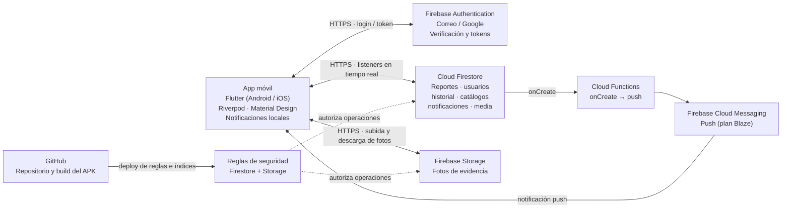
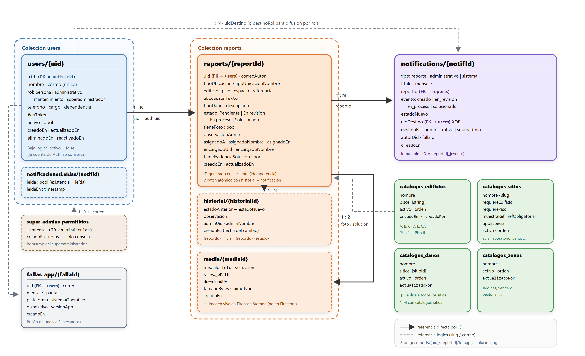

# 4.2. Diseño de la Arquitectura del Sistema

El sistema **REPCAMPUSOFT** sigue un modelo de arquitectura **cliente-servidor en capas**,
en el que la aplicación móvil delega la lógica de negocio, la persistencia y la
autenticación en servicios administrados en la nube de **Firebase** (modelo *Backend
as a Service*, BaaS), por lo que no requiere mantener un servidor propio ni una base
de datos instalada en infraestructura local. La arquitectura está compuesta por cinco
componentes principales: la **aplicación móvil desarrollada en Flutter** (Android e
iOS), **Firebase Authentication** para el registro e inicio de sesión con correo
institucional o cuenta de Google, **Cloud Firestore** como base de datos documental en
tiempo real (reportes, usuarios, historial de estados, catálogos, notificaciones y
medios), **Firebase Storage** para el almacenamiento de las fotografías de evidencia y
**Firebase Cloud Messaging** junto con el servicio de notificaciones locales para la
entrega de avisos. De forma transversal, las **reglas de seguridad de Firestore y
Storage** validan la autoría, el rol y el estado de cada operación directamente en el
servidor, y el repositorio en **GitHub** concentra el código fuente y el despliegue de
reglas e índices mediante Firebase CLI. La Figura 1 presenta el diagrama de
arquitectura global del sistema.

*Figura 1. Arquitectura global de REPCAMPUSOFT (Flutter + Firebase).*

Internamente, la aplicación se organiza por *features* con cuatro capas: **presentación**
(widgets y pantallas en Flutter), **estado** (Riverpod: providers, streams y estado de
sesión), **dominio** (entidades, reglas de negocio y contratos de repositorio) y **datos**
(implementaciones de Firebase para autenticación, Firestore y almacenamiento). Esta
separación permite sustituir una implementación (por ejemplo, cambiar el almacenamiento
de fotos o el servicio de notificaciones) sin modificar las pantallas. La persistencia
*offline* de Firestore permite **consultar** reportes sin conexión y sincronizarlos al
reconectarse; la **creación** de reportes exige conexión porque la fotografía es
obligatoria y se escribe de forma **atómica** en un `WriteBatch` junto con el reporte,
su historial inicial y la notificación al área administrativa. El *push* con la
aplicación cerrada se habilitará al migrar al plan **Blaze** mediante Cloud Functions y
FCM; en la versión actual los listeners de Firestore alimentan las notificaciones
locales dentro de la aplicación.

## 4.2.1. Capa de Presentación: Flutter

La capa de presentación corresponde a la aplicación móvil desarrollada en **Flutter
con el lenguaje Dart**, que constituye el punto de interacción directa con los
usuarios del sistema (estudiantes y personal administrativo). Esta capa se comunica
de forma **bidireccional** con los servicios en la nube de Firebase a través de los
**SDK oficiales sobre HTTPS**, sin una API REST intermedia: envía solicitudes de
**autenticación** (registro, inicio de sesión con correo institucional o cuenta de
Google, verificación de correo y recuperación de contraseña), operaciones sobre
**Cloud Firestore** (creación de reportes de daño, actualización de estados,
historial, notificaciones y catálogos) y la transferencia de las **fotografías de
evidencia** hacia Firebase Storage. Las respuestas se reciben como documentos,
listas y *streams* en tiempo real que **Riverpod** transforma en estado reactivo
para su procesamiento y visualización, de modo que la interfaz se actualiza
automáticamente cuando cambia un reporte o una notificación.

El archivo de arranque `lib/main.dart` cumple una función de **inicialización y
composición** de dependencias, no de interfaz. En primer lugar, `WidgetsFlutterBinding.ensureInitialized()`
prepara los canales de plataforma antes de invocar cualquier plugin; a
continuación se desactiva la descarga de fuentes en tiempo de ejecución
(`GoogleFonts.config.allowRuntimeFetching = false`) para usar las fuentes **Inter
empaquetadas en el APK**, evitando descargas en el primer arranque y saltos de
tipografía cuando no hay conexión. Después se inicializa el proyecto con
`Firebase.initializeApp(options: DefaultFirebaseOptions.currentPlatform)`, que
selecciona la configuración del proyecto **repcampusoft** según la plataforma
(Android o iOS). Antes de `runApp` se registra el manejador de mensajes en
segundo plano (`FirebaseMessaging.onBackgroundMessage`), requisito de la
plataforma para recibir *push* con la aplicación cerrada. Finalmente, `runApp`
envuelve el widget raíz en un **`ProviderScope`** con los *overrides* de los
repositorios reales (`reportesOverrides`, `notificacionesOverrides` y
`catalogosOverrides`), punto único donde la aplicación conecta sus contratos de
dominio con las implementaciones de Firebase y donde las pruebas los sustituyen
por dobles.

El **widget raíz** (`lib/app.dart`) es un `ConsumerWidget` que construye un
`MaterialApp.router` con el título de la aplicación, el tema `AppTheme.light()`
—**Material 3** con semilla del verde institucional de la UTS, tipografía Inter,
botones y campos redondeados—, el `routerConfig` con **GoRouter**, que declara las
rutas de forma centralizada y aplica las **guardas de navegación** según el estado
de la sesión, y la localización fijada en `es` con los delegados globales de
Material, Widgets y Cupertino. Además, `ref.watch(notificacionesBootstrapProvider)`
arranca una sola vez los servicios de notificación de forma **diferida**
(*post-frame*), para que el registro de FCM y la creación del canal de
notificaciones locales no compitan con el primer pintado de la interfaz.

**Flutter** fue seleccionado por su capacidad de compilación nativa para **Android
e iOS desde una única base de código**, su rendimiento equivalente al de una
aplicación nativa y su sistema de **widgets declarativos** bajo los lineamientos de
**Material Design**, lo que garantiza una interfaz consistente y usable para
perfiles sin conocimientos técnicos avanzados. La **gestión del estado global** se
implementa con **Riverpod** (`Provider`, `Notifier` y *providers* derivados), que
frente a `ChangeNotifierProvider` ofrece providers inmutables, composición segura,
pruebas unitarias sin `BuildContext` e inyección por *overrides*. La **persistencia
de la sesión** no se implementa con tokens almacenados manualmente en
`SharedPreferences`: el SDK de **Firebase Authentication** conserva la sesión
cifrada en el almacenamiento seguro del dispositivo y **renueva automáticamente el
ID token** (JWT firmado por Firebase) antes de que expire. Sobre ese mecanismo,
`SesionController` escucha `authStateChanges` y resuelve el **control de acceso en
cinco estados** —sin sesión, correo pendiente de verificación, perfil/rol
pendiente, rol aplicado y cuenta bloqueada— consultando el documento
`users/{uid}` en Firestore; `GoRouter` redirige a la pantalla correspondiente cada
vez que cambia dicho estado.

Adicionalmente, la aplicación se integra con **Firebase Cloud Messaging** para la
recepción de notificaciones *push* en los tres estados posibles: **foreground,
background y terminated**. En primer plano, la alerta la muestra el servicio de
**notificaciones locales**, que escucha la colección `notifications` de Firestore
y desactiva la presentación automática de FCM para no duplicar avisos; en segundo
plano y con la aplicación cerrada, la notificación la presenta el sistema
operativo y el manejador de *background* solo registra el mensaje para depuración.
Al tocar una notificación, `onMessageOpenedApp` y `getInitialMessage` recuperan el
identificador del reporte y abren su pantalla de detalle o de gestión según el
rol. Al iniciar sesión, el dispositivo genera su **token FCM** y lo registra en
`users/{uid}.fcmToken`, lo renueva con `onTokenRefresh` y lo elimina al cerrar
sesión, de modo que el equipo deja de recibir avisos de una cuenta que ya no está
activa. El envío de *push* originado en el servidor (Cloud Functions al crear un
reporte) queda previsto al migrar al plan **Blaze**.

La **estructura de archivos del frontend** refleja la organización por *features*
descrita: `lib/main.dart` (arranque), `lib/app.dart` (widget raíz y tema),
`lib/core/` (rutas y guardas de sesión, tema y tipografía, utilidades y
validadores, catálogos de espacios), `lib/features/` (auth, home, reportes,
admin, notificaciones, usuarios, perfil, fallas de la aplicación y catálogos, cada
uno con sus capas `presentation`, `data` y `domain`) y `lib/shared/` (widgets
reutilizables como `LabelledField`, `MonthSelector` y diálogos). El repositorio
incluye además `test/`, con más de 320 pruebas automatizadas, y `dist/`, con el APK
de distribución generado desde este mismo código.

## Componentes de la arquitectura

| Componente | Tecnología | Función |
| :--- | :--- | :--- |
| Aplicación móvil | Flutter (Dart), Riverpod, Material Design | Interfaz Android/iOS, estado, validaciones y persistencia local |
| Autenticación | Firebase Authentication | Registro, inicio con correo/Google, verificación y tokens |
| Base de datos | Cloud Firestore | Reportes, usuarios, historial, catálogos, notificaciones y media |
| Almacenamiento de fotos | Firebase Storage (con respaldo en Firestore) | Evidencia fotográfica de reportes y soluciones |
| Notificaciones | FCM + notificaciones locales | Avisos en tiempo real dentro de la app y push futuro (Blaze) |
| Seguridad | Reglas de Firestore y Storage | Autorización por rol, autoría y estado de cuenta |
| Repositorio y despliegue | GitHub + Firebase CLI | Control de versiones, reglas, índices y build del APK |

## Diagrama en Mermaid (editable)

---

## 4.3. Diseño y estructuración de la base de datos

La persistencia de **REPCAMPUSOFT** se implementa sobre **Cloud Firestore**, la base
de datos **documental y NoSQL** de Firebase. A diferencia de un modelo relacional,
la información se organiza en **colecciones** que agrupan **documentos** en formato
JSON (pares campo–valor) y cada documento se identifica por una ruta jerárquica
única, por ejemplo `users/{uid}` o `reports/{reportId}/historial/{historialId}`.
Este diseño se eligió porque los datos del sistema tienen forma natural de
documento (un reporte con su ubicación, su estado y sus evidencias), porque
permite **sincronización en tiempo real** con la interfaz mediante *snapshots* y
porque habilita el **modo sin conexión** con caché local, lo que resulta adecuado
para un campus con conectividad irregular.

El modelo aplica las siguientes convenciones de diseño:

- **Nombres del dominio en español** para colecciones, campos y estados
  (`reports`, `historial`, `estado`, `Pendiente`), en coherencia con las reglas de
  codificación del proyecto.
- **Identificadores legibles y deterministas** cuando la operación debe ser
  idempotente: el reporte recibe su ID en el cliente antes de armar el lote y de
  él se derivan `historialId = {reportId}_inicial`,
  `{reportId}_{estadoNuevo}` y `notifId = {reportId}_{evento}`.
- **Fechas con `FieldValue.serverTimestamp()`** (`creadoEn`, `actualizadoEn`,
  `leidaEn`), de modo que la hora la asigne el servidor y no el dispositivo.
- **Baja lógica** (`activo: false`) en lugar de borrado físico de usuarios, para
  conservar la trazabilidad de los reportes y del historial.
- **Autorreferencia por ID** (`uid`, `reportId`, `asignadoA`, `uidDestino`) en
  lugar de documentos anidados, lo que evita duplicar datos y permite consultas
  por colección con índices compuestos.

La **Figura 2** presenta el modelo de datos con las colecciones, sus campos
principales y las relaciones entre ellas.

*Figura 2. Modelo de datos (colecciones y relaciones) de REPCAMPUSOFT.*

### Entidades del modelo

| # | Colección / ruta | Clave | Propósito | Cardinalidad principal |
| :-: | :--- | :--- | :--- | :--- |
| 1 | `users/{uid}` | `uid` (= `auth.uid`) | Perfil, rol y estado de la cuenta | 1 : N con `reports`, `notifications` y `fallas_app` |
| 2 | `users/{uid}/notificacionesLeidas/{notifId}` | `notifId` | Marca de lectura por usuario | N : 1 con `notifications` |
| 3 | `super_admins_permitidos/{correo}` | correo en minúsculas | Lista blanca de bootstrap del superadministrador | 1 : 0..1 con `users` |
| 4 | `reports/{reportId}` | `reportId` | Reporte de daño y su estado | 1 : N con `historial` y `notifications`; 1 : 2 con `media` |
| 5 | `reports/{reportId}/historial/{historialId}` | `historialId` | Trazabilidad de los cambios de estado | N : 1 con `reports` |
| 6 | `reports/{reportId}/media/{mediaId}` | `mediaId` = `foto` \| `solucion` | Metadatos de la evidencia fotográfica almacenada en Storage | N : 1 con `reports` |
| 7 | `notifications/{notifId}` | `notifId` | Bandeja de avisos (dirigidos o por rol) | N : 1 con `reports`; N : 0..1 con `users` |
| 8 | `catalogos_edificios/{id}` | `id` (slug) | Edificios y sus pisos | 1 : N con `catalogos_sitios` (por uso) |
| 9 | `catalogos_sitios/{id}` | `id` (slug) | Tipos de espacio y reglas del formulario | N : M con `catalogos_danos` |
| 10 | `catalogos_danos/{id}` | `id` (slug) | Tipos de daño y sitios donde aplican | N : M con `catalogos_sitios` |
| 11 | `catalogos_zonas/{id}` | `id` (slug) | Zonas exteriores del campus | 1 : N con `reports` (por nombre) |
| 12 | `fallas_app/{fallaId}` | `fallaId` | Buzón de fallas de la aplicación (sin estados) | N : 1 con `users` |
| 13 | Firebase Storage `reports/{uid}/{reportId}/…` | ruta | Archivos `foto.jpg` y `solucion.jpg` | 1 : 1 con los documentos de `media` |

### Descripción de las entidades

**`users/{uid}` — Usuario.** Documento raíz del perfil; su ID es el UID que
Firebase Authentication asigna a la cuenta, por lo que la relación con el sistema
de autenticación es **1 : 1** y no requiere campo adicional. Almacena `nombre`,
`correo` (único y verificado), `rol` (`persona`, `administrativo`, `mantenimiento`
o `superadministrador`), `telefono`, `cargo` y `dependencia` (estos dos últimos
solo para cuentas administrativas creadas por el superadministrador), `fcmToken`
para notificaciones, `activo` para la baja lógica, `eliminadoEn`/`reactivadoEn`
como rastro de auditoría y las marcas `creadoEn`/`actualizadoEn`. El rol es
**inmutable** después de la creación: las reglas de Firestore impiden que el
propietario lo modifique o se auto-promueva.

**`users/{uid}/notificacionesLeidas/{notifId}` — Estado de lectura.** Subcolección de `users` que
registra **qué avisos leyó cada usuario**. La sola existencia del documento
`{notifId}` significa «leída» y `leidaEn` guarda el instante. Se separó del
documento principal de la notificación porque un aviso de difusión
(`destinoRol`) debe poder marcarse como leído de forma **independiente por cada
administrativo**, y porque así el badge de no leídas se calcula por intersección
sin alterar el aviso original, que es inmutable.

**`reports/{reportId}` — Reporte de daño.** Entidad central del sistema. Guarda
`uid` y `correoAutor` (autor), `tipoUbicacion` (slug del catálogo) y
`tipoUbicacionNombre`, `edificio`, `piso`, `espacio`, `referencia` y el texto
consolidado `ubicacionTexto`; la descripción y clasificación (`tipoDano`,
`descripcion`); el estado (`Pendiente`, `En revision`, `En proceso`,
`Solucionado`); las banderas `tieneFoto` y `tieneEvidenciaSolucion`; los datos de
atención (`observacionAdmin`, `asignadoA`, `asignadoNombre`, `asignadoEn`,
`encargadoUid`, `encargadoNombre`) y `creadoEn`/`actualizadoEn`. La creación se
ejecuta en un **`WriteBatch` atómico** que escribe simultáneamente el reporte, su
historial inicial, la notificación al área administrativa y el documento de
metadatos de la foto; si una parte falla, nada se persiste.

**`reports/{reportId}/historial/{historialId}` — Historial de estados.**
Subcolección **inmutable** (sin `update` ni `delete`) que registra cada
transición con `estadoAnterior`, `estadoNuevo`, `observacion`, `adminUid`,
`adminNombre` y `creadoEn`. Los IDs son deterministas
(`{reportId}_inicial` para el alta y `{reportId}_{estadoNuevo}` para cada
transición), lo que evita duplicados si el cliente reintenta la operación. La
máquina de estados es acíclica (`Pendiente → En revision → En proceso →
Solucionado`), por lo que existe como máximo un documento por estado alcanzado.

**`reports/{reportId}/media/{mediaId}` — Evidencia fotográfica.** Documento
separado del reporte para no acercarse al límite de **1 MiB** por documento y
para que las consultas de lista no descarguen imágenes. Contiene `storagePath`,
`downloadUrl`, `tamanoBytes`, `mimeType` y `creadoEn`; los archivos físicos viven
en **Firebase Storage** (`reports/{uid}/{reportId}/foto.jpg` y `solucion.jpg`), de
modo que el documento solo conserva metadatos y la URL de descarga. El `mediaId`
es fijo (`foto` al crear, `solucion` al cerrar) y se admiten documentos heredados
con el campo `base64` para las imágenes antiguas.

**`notifications/{notifId}` — Notificación.** Aviso inmutable con `tipo`
(`reporte`, `administrativo`, `sistema`), `titulo`, `mensaje`, `reportId`,
`evento`, `estadoNuevo`, `autorUid`, `creadoEn` y **exactamente uno** de dos
destinos: `uidDestino` (aviso dirigido al autor de un reporte) o `destinoRol`
(difusión a un rol, típicamente `administrativo`). El ID derivado
`{reportId}_{evento}` garantiza una única notificación por transición. El campo
`fallaId` se usa cuando el aviso proviene de una falla de la aplicación.

**Catálogos (`catalogos_edificios`, `catalogos_sitios`, `catalogos_danos`,
`catalogos_zonas`).** Colecciones de configuración administradas por el rol de
mantenimiento y el superadministrador. `catalogos_edificios` guarda `nombre` y el
arreglo `pisos`; `catalogos_sitios` define el comportamiento del formulario
(`requiereEdificio`, `requierePiso`, `muestraReferencia`, `referenciaObligatoria`,
`tipoEspecial`); `catalogos_danos` guarda `nombre` y el arreglo `sitios` con los
IDs donde aplica (vacío = todos), y `catalogos_zonas` las zonas exteriores. Todos
incluyen `activo`, `orden` y marcas de creación/actualización con el UID que
modificó.

**`fallas_app/{fallaId}` — Falla de la aplicación.** Buzón de una sola vía donde
cualquier usuario autenticado reporta un error de la app. Almacena `uid`,
`correo`, `mensaje`, `pantalla`, datos técnicos del dispositivo (`plataforma`,
`sistemaOperativo`, `dispositivo`, `versionApp`) y `creadoEn`. No tiene estados ni
seguimiento y solo lo puede leer el superadministrador.

**`super_admins_permitidos/{correo}`.** Lista blanca **sin acceso desde la app**
(solo consola) que habilita el *bootstrap* del superadministrador: la regla de
creación de `users` exige que el correo sembrado aquí exista para poder asignar
ese rol.

### Relaciones e integridad referencial

| Relación | Tipo | Campo de enlace | Integridad |
| :--- | :--- | :--- | :--- |
| `users` → `reports` | 1 : N | `reports.uid` | El autor solo crea reportes con su propio `uid`; el reporte nunca se borra |
| `users` → `notifications` | 1 : N | `notifications.uidDestino` | Solo recibe avisos dirigidos a su UID |
| `users` (rol) → `notifications` | 1 : N | `notifications.destinoRol` | Difusión filtrada por rol en las reglas de lectura |
| `reports` → `historial` | 1 : N | subcolección | Solo se crea dentro de la transición válida; inmutable |
| `reports` → `media` | 1 : 2 | `mediaId` (`foto` / `solucion`) | La foto es obligatoria al crear; la de solución, al pasar a `Solucionado` |
| `reports` → `notifications` | 1 : N | `notifications.reportId` | ID determinista por evento evita duplicados |
| `notifications` → `notificacionesLeidas` | 1 : N | `notifId` | Solo el dueño marca lectura y solo de avisos que puede ver |
| `users` → `fallas_app` | 1 : N | `fallas_app.uid` | Cada usuario ve las suyas; el superadministrador todas |
| `users` → `super_admins_permitidos` | 1 : 0..1 | `correo` | Habilita únicamente el rol de superadministrador |
| `catalogos_sitios` ↔ `catalogos_danos` | N : M | `catalogos_danos.sitios[]` | Arreglo de IDs; vacío significa «todos los sitios» |
| `catalogos_*` → `reports` | referencia lógica | `tipoUbicacion`, `tipoDano`, `edificio` | Se guarda el valor vigente al crear el reporte (instantánea histórica) |

Firestore **no impone claves foráneas**; la integridad se garantiza en tres
frentes: **(1)** el cliente escribe siempre dentro de lotes o transacciones
atómicas, **(2)** las **reglas de seguridad** verifican autoría, rol, estado y
campos permitidos en cada escritura, y **(3)** las consultas usan índices
compuestos para que las lecturas por `uid`, `estado`, `edificio` o `destinoRol`
sean eficientes. La relación con los catálogos es **lógica, no relacional**: el
reporte guarda el slug y el nombre vigentes en el momento de su creación, de modo
que si un catálogo cambia o se desactiva, los reportes históricos conservan la
ubicación y el tipo de daño con los que fueron registrados.

### Denormalización controlada

El modelo incorpora duplicaciones deliberadas para reducir lecturas y mantener la
coherencia histórica:

- **`ubicacionTexto`** guarda la ubicación ya armada
  (`Edificio A · Piso 3 · Salón 305`) para que listas, detalle, exportaciones y
  notificaciones no tengan que reconstruirla ni leer los catálogos.
- **`correoAutor`**, **`asignadoNombre`** y **`encargadoNombre`** copian datos del
  usuario en el reporte y en el historial, de modo que la auditoría siga siendo
  legible aunque el perfil se actualice o la cuenta se deshabilite.
- **`tipoUbicacionNombre`** conserva el nombre visible del sitio, incluidos los
  sitios personalizados que no existen en la enumeración original.
- **`tieneFoto` / `tieneEvidenciaSolucion`** son banderas derivadas que permiten a
  las listas saber si hay evidencia sin leer la subcolección `media`.

### Índices y rendimiento

Las consultas principales se resuelven con **ocho índices compuestos** declarados
en `firestore.indexes.json` y desplegados con Firebase CLI: cuatro sobre
`reports` (`uid + creadoEn`, `estado + creadoEn`, `edificio + creadoEn` y
`estado + edificio + creadoEn`) y cuatro sobre `notifications`
(`uidDestino + creadoEn`, `uidDestino + tipo + creadoEn`,
`destinoRol + creadoEn` y `destinoRol + tipo + creadoEn`). La bandeja de
notificaciones se consulta por **rango de mes** en lugar de descargar todo el
historial, y el estado de lectura se resuelve por lotes de hasta 30 IDs (límite
de `whereIn`). El historial es una subcolección independiente, por lo que el
documento del reporte se mantiene pequeño y las listas no lo arrastran.

### Seguridad del modelo

Las reglas de Firestore y de Storage actúan como última línea de defensa: validan
que el reporte se cree con `uid` y `correoAutor` del usuario autenticado, con
estado `Pendiente` y con la foto ya presente en el mismo lote
(`existsAfter(...)`); que solo el personal autorizado cambie de estado y siempre
por transiciones válidas; que un reporte solucionado incluya evidencia
fotográfica; que las notificaciones e historiales no se puedan modificar ni
borrar; y que la cuenta esté activa (`activo == true`) para cualquier operación.
En Storage, la ruta incluye el UID de quien sube (`reports/{uid}/{reportId}/…`)
para que la propiedad se pueda verificar sin consultar Firestore.

