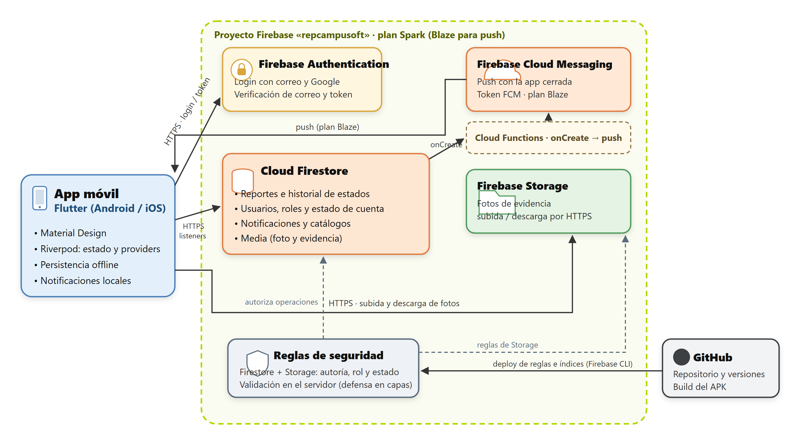
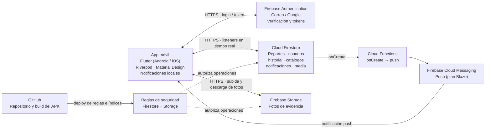

# 4.2. Diseño de la Arquitectura del Sistema

El sistema **REPCAMPUSOFT** sigue un modelo de arquitectura **cliente-servidor en capas**,
en el que la aplicación móvil delega la lógica de negocio, la persistencia y la
autenticación en servicios administrados en la nube de **Firebase** (modelo *Backend
as a Service*, BaaS), por lo que no requiere mantener un servidor propio ni una base
de datos instalada en infraestructura local. La arquitectura está compuesta por cinco
componentes principales: la **aplicación móvil desarrollada en Flutter** (Android e
iOS), **Firebase Authentication** para el registro e inicio de sesión con correo
institucional o cuenta de Google, **Cloud Firestore** como base de datos documental en
tiempo real (reportes, usuarios, historial de estados, catálogos, notificaciones y
medios), **Firebase Storage** para el almacenamiento de las fotografías de evidencia y
**Firebase Cloud Messaging** junto con el servicio de notificaciones locales para la
entrega de avisos. De forma transversal, las **reglas de seguridad de Firestore y
Storage** validan la autoría, el rol y el estado de cada operación directamente en el
servidor, y el repositorio en **GitHub** concentra el código fuente y el despliegue de
reglas e índices mediante Firebase CLI. La Figura 1 presenta el diagrama de
arquitectura global del sistema.

*Figura 1. Arquitectura global de REPCAMPUSOFT (Flutter + Firebase).*

Internamente, la aplicación se organiza por *features* con cuatro capas: **presentación**
(widgets y pantallas en Flutter), **estado** (Riverpod: providers, streams y estado de
sesión), **dominio** (entidades, reglas de negocio y contratos de repositorio) y **datos**
(implementaciones de Firebase para autenticación, Firestore y almacenamiento). Esta
separación permite sustituir una implementación (por ejemplo, cambiar el almacenamiento
de fotos o el servicio de notificaciones) sin modificar las pantallas. La persistencia
*offline* de Firestore permite **consultar** reportes sin conexión y sincronizarlos al
reconectarse; la **creación** de reportes exige conexión porque la fotografía es
obligatoria y se escribe de forma **atómica** en un `WriteBatch` junto con el reporte,
su historial inicial y la notificación al área administrativa. El *push* con la
aplicación cerrada se habilitará al migrar al plan **Blaze** mediante Cloud Functions y
FCM; en la versión actual los listeners de Firestore alimentan las notificaciones
locales dentro de la aplicación.

## Componentes de la arquitectura

| Componente | Tecnología | Función |
| :--- | :--- | :--- |
| Aplicación móvil | Flutter (Dart), Riverpod, Material Design | Interfaz Android/iOS, estado, validaciones y persistencia local |
| Autenticación | Firebase Authentication | Registro, inicio con correo/Google, verificación y tokens |
| Base de datos | Cloud Firestore | Reportes, usuarios, historial, catálogos, notificaciones y media |
| Almacenamiento de fotos | Firebase Storage (con respaldo en Firestore) | Evidencia fotográfica de reportes y soluciones |
| Notificaciones | FCM + notificaciones locales | Avisos en tiempo real dentro de la app y push futuro (Blaze) |
| Seguridad | Reglas de Firestore y Storage | Autorización por rol, autoría y estado de cuenta |
| Repositorio y despliegue | GitHub + Firebase CLI | Control de versiones, reglas, índices y build del APK |

## Diagrama en Mermaid (editable)

