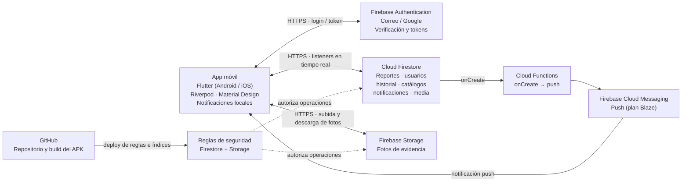

# 4.2. Diseño de la Arquitectura del Sistema

El sistema **REPCAMPUSOFT** sigue un modelo de arquitectura **cliente-servidor en capas**,
en el que la aplicación móvil delega la lógica de negocio, la persistencia y la
autenticación en servicios administrados en la nube de **Firebase** (modelo *Backend
as a Service*, BaaS), por lo que no requiere mantener un servidor propio ni una base
de datos instalada en infraestructura local. La arquitectura está compuesta por cinco
componentes principales: la **aplicación móvil desarrollada en Flutter** (Android e
iOS), **Firebase Authentication** para el registro e inicio de sesión con correo
institucional o cuenta de Google, **Cloud Firestore** como base de datos documental en
tiempo real (reportes, usuarios, historial de estados, catálogos, notificaciones y
medios), **Firebase Storage** para el almacenamiento de las fotografías de evidencia y
**Firebase Cloud Messaging** junto con el servicio de notificaciones locales para la
entrega de avisos. De forma transversal, las **reglas de seguridad de Firestore y
Storage** validan la autoría, el rol y el estado de cada operación directamente en el
servidor, y el repositorio en **GitHub** concentra el código fuente y el despliegue de
reglas e índices mediante Firebase CLI. La Figura 1 presenta el diagrama de
arquitectura global del sistema.

*Figura 1. Arquitectura global de REPCAMPUSOFT (Flutter + Firebase).*

Internamente, la aplicación se organiza por *features* con cuatro capas: **presentación**
(widgets y pantallas en Flutter), **estado** (Riverpod: providers, streams y estado de
sesión), **dominio** (entidades, reglas de negocio y contratos de repositorio) y **datos**
(implementaciones de Firebase para autenticación, Firestore y almacenamiento). Esta
separación permite sustituir una implementación (por ejemplo, cambiar el almacenamiento
de fotos o el servicio de notificaciones) sin modificar las pantallas. La persistencia
*offline* de Firestore permite **consultar** reportes sin conexión y sincronizarlos al
reconectarse; la **creación** de reportes exige conexión porque la fotografía es
obligatoria y se escribe de forma **atómica** en un `WriteBatch` junto con el reporte,
su historial inicial y la notificación al área administrativa. El *push* con la
aplicación cerrada se habilitará al migrar al plan **Blaze** mediante Cloud Functions y
FCM; en la versión actual los listeners de Firestore alimentan las notificaciones
locales dentro de la aplicación.

## 4.2.1. Capa de Presentación: Flutter

La capa de presentación corresponde a la aplicación móvil desarrollada en **Flutter
con el lenguaje Dart**, que constituye el punto de interacción directa con los
usuarios del sistema (estudiantes y personal administrativo). Esta capa se comunica
de forma **bidireccional** con los servicios en la nube de Firebase a través de los
**SDK oficiales sobre HTTPS**, sin una API REST intermedia: envía solicitudes de
**autenticación** (registro, inicio de sesión con correo institucional o cuenta de
Google, verificación de correo y recuperación de contraseña), operaciones sobre
**Cloud Firestore** (creación de reportes de daño, actualización de estados,
historial, notificaciones y catálogos) y la transferencia de las **fotografías de
evidencia** hacia Firebase Storage. Las respuestas se reciben como documentos,
listas y *streams* en tiempo real que **Riverpod** transforma en estado reactivo
para su procesamiento y visualización, de modo que la interfaz se actualiza
automáticamente cuando cambia un reporte o una notificación.

El archivo de arranque `lib/main.dart` cumple una función de **inicialización y
composición** de dependencias, no de interfaz. En primer lugar, `WidgetsFlutterBinding.ensureInitialized()`
prepara los canales de plataforma antes de invocar cualquier plugin; a
continuación se desactiva la descarga de fuentes en tiempo de ejecución
(`GoogleFonts.config.allowRuntimeFetching = false`) para usar las fuentes **Inter
empaquetadas en el APK**, evitando descargas en el primer arranque y saltos de
tipografía cuando no hay conexión. Después se inicializa el proyecto con
`Firebase.initializeApp(options: DefaultFirebaseOptions.currentPlatform)`, que
selecciona la configuración del proyecto **repcampusoft** según la plataforma
(Android o iOS). Antes de `runApp` se registra el manejador de mensajes en
segundo plano (`FirebaseMessaging.onBackgroundMessage`), requisito de la
plataforma para recibir *push* con la aplicación cerrada. Finalmente, `runApp`
envuelve el widget raíz en un **`ProviderScope`** con los *overrides* de los
repositorios reales (`reportesOverrides`, `notificacionesOverrides` y
`catalogosOverrides`), punto único donde la aplicación conecta sus contratos de
dominio con las implementaciones de Firebase y donde las pruebas los sustituyen
por dobles.

El **widget raíz** (`lib/app.dart`) es un `ConsumerWidget` que construye un
`MaterialApp.router` con el título de la aplicación, el tema `AppTheme.light()`
—**Material 3** con semilla del verde institucional de la UTS, tipografía Inter,
botones y campos redondeados—, el `routerConfig` con **GoRouter**, que declara las
rutas de forma centralizada y aplica las **guardas de navegación** según el estado
de la sesión, y la localización fijada en `es` con los delegados globales de
Material, Widgets y Cupertino. Además, `ref.watch(notificacionesBootstrapProvider)`
arranca una sola vez los servicios de notificación de forma **diferida**
(*post-frame*), para que el registro de FCM y la creación del canal de
notificaciones locales no compitan con el primer pintado de la interfaz.

**Flutter** fue seleccionado por su capacidad de compilación nativa para **Android
e iOS desde una única base de código**, su rendimiento equivalente al de una
aplicación nativa y su sistema de **widgets declarativos** bajo los lineamientos de
**Material Design**, lo que garantiza una interfaz consistente y usable para
perfiles sin conocimientos técnicos avanzados. La **gestión del estado global** se
implementa con **Riverpod** (`Provider`, `Notifier` y *providers* derivados), que
frente a `ChangeNotifierProvider` ofrece providers inmutables, composición segura,
pruebas unitarias sin `BuildContext` e inyección por *overrides*. La **persistencia
de la sesión** no se implementa con tokens almacenados manualmente en
`SharedPreferences`: el SDK de **Firebase Authentication** conserva la sesión
cifrada en el almacenamiento seguro del dispositivo y **renueva automáticamente el
ID token** (JWT firmado por Firebase) antes de que expire. Sobre ese mecanismo,
`SesionController` escucha `authStateChanges` y resuelve el **control de acceso en
cinco estados** —sin sesión, correo pendiente de verificación, perfil/rol
pendiente, rol aplicado y cuenta bloqueada— consultando el documento
`users/{uid}` en Firestore; `GoRouter` redirige a la pantalla correspondiente cada
vez que cambia dicho estado.

Adicionalmente, la aplicación se integra con **Firebase Cloud Messaging** para la
recepción de notificaciones *push* en los tres estados posibles: **foreground,
background y terminated**. En primer plano, la alerta la muestra el servicio de
**notificaciones locales**, que escucha la colección `notifications` de Firestore
y desactiva la presentación automática de FCM para no duplicar avisos; en segundo
plano y con la aplicación cerrada, la notificación la presenta el sistema
operativo y el manejador de *background* solo registra el mensaje para depuración.
Al tocar una notificación, `onMessageOpenedApp` y `getInitialMessage` recuperan el
identificador del reporte y abren su pantalla de detalle o de gestión según el
rol. Al iniciar sesión, el dispositivo genera su **token FCM** y lo registra en
`users/{uid}.fcmToken`, lo renueva con `onTokenRefresh` y lo elimina al cerrar
sesión, de modo que el equipo deja de recibir avisos de una cuenta que ya no está
activa. El envío de *push* originado en el servidor (Cloud Functions al crear un
reporte) queda previsto al migrar al plan **Blaze**.

La **estructura de archivos del frontend** refleja la organización por *features*
descrita: `lib/main.dart` (arranque), `lib/app.dart` (widget raíz y tema),
`lib/core/` (rutas y guardas de sesión, tema y tipografía, utilidades y
validadores, catálogos de espacios), `lib/features/` (auth, home, reportes,
admin, notificaciones, usuarios, perfil, fallas de la aplicación y catálogos, cada
uno con sus capas `presentation`, `data` y `domain`) y `lib/shared/` (widgets
reutilizables como `LabelledField`, `MonthSelector` y diálogos). El repositorio
incluye además `test/`, con más de 320 pruebas automatizadas, y `dist/`, con el APK
de distribución generado desde este mismo código.

## Componentes de la arquitectura

| Componente | Tecnología | Función |
| :--- | :--- | :--- |
| Aplicación móvil | Flutter (Dart), Riverpod, Material Design | Interfaz Android/iOS, estado, validaciones y persistencia local |
| Autenticación | Firebase Authentication | Registro, inicio con correo/Google, verificación y tokens |
| Base de datos | Cloud Firestore | Reportes, usuarios, historial, catálogos, notificaciones y media |
| Almacenamiento de fotos | Firebase Storage (con respaldo en Firestore) | Evidencia fotográfica de reportes y soluciones |
| Notificaciones | FCM + notificaciones locales | Avisos en tiempo real dentro de la app y push futuro (Blaze) |
| Seguridad | Reglas de Firestore y Storage | Autorización por rol, autoría y estado de cuenta |
| Repositorio y despliegue | GitHub + Firebase CLI | Control de versiones, reglas, índices y build del APK |

## Diagrama en Mermaid (editable)

