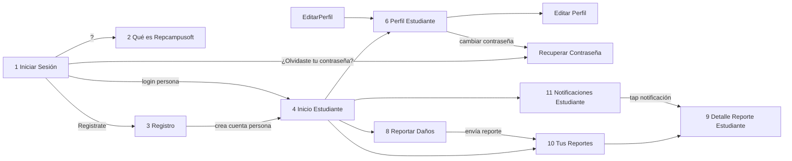
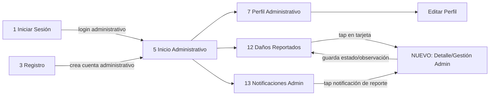
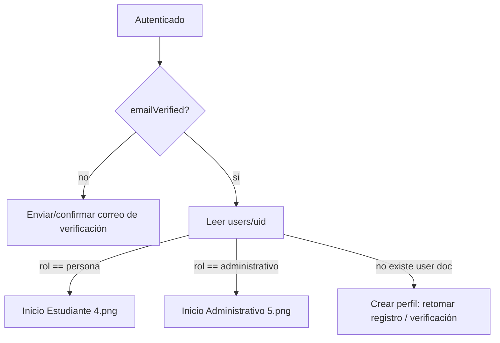
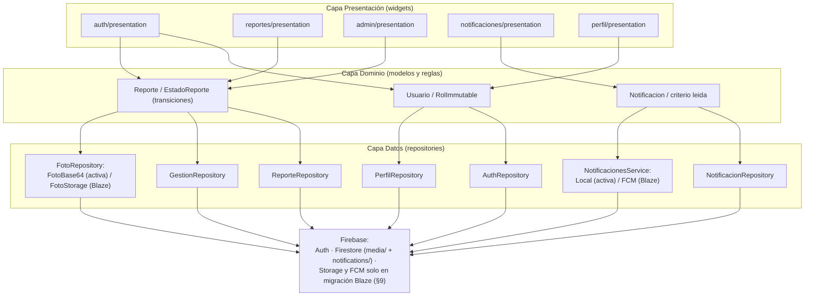

# Arquitectura de Software - REPCAMPUSOFT (Fase 2: Diseño)

Documento técnico que define la arquitectura del sistema, el modelo de datos, las reglas de seguridad, los flujos de autenticación, la navegación y las dependencias del proyecto.

**Entradas base**: `AGENTS.md`, `docs/requisitos.md`, `docs/diseno/pantallas.md`.

---

## 1. Arquitectura por Capas y Estructura de Carpetas Flutter

La aplicación se organiza con **arquitectura por capas** (aviso/rings) dentro de una **organización por features** (regla de código de `AGENTS.md`). En cada feature, las capas `data`, `domain` y `presentation` tienen una dependencia unidireccional:

- `presentation` → `domain` → `data` → Firebase.
- `core` es compartido (infraestructura transversal) y no conoce features concretas.

### 1.1. Arbol de Carpetas

```
lib/
├── core/
│   ├── theme/                 # Colores UTS, tipografía, estilos (Design System de pantallas.md)
│   │   ├── app_colors.dart
│   │   ├── app_typography.dart
│   │   ├── app_theme.dart
│   │   └── estado_reporte_style.dart   # Color + icono por estado (Pendiente, En revisión, ...)
│   ├── routes/                # Definición central de rutas (named routes / go_router)
│   │   └── app_router.dart
│   ├── constants/             # Catálogos locales (tipos de daño, edificios) y cadenas
│   │   ├── catalogo_tipos_dano.dart
│   │   └── catalogo_edificios.dart
│   └── utils/                 # Validadores, formateadores de fecha, resultados (sealed result)
│       ├── validators.dart
│       ├── date_formatters.dart
│       └── results.dart
├── features/
│   ├── auth/
│   │   ├── data/              # AuthRepository, AuthRemoteDataSource (FirebaseAuth + users/...)
│   │   ├── domain/            # Usuario, RolEnum, caso de uso Login/Registro/ResetPassword
│   │   └── presentation/      # LoginScreen, RegisterScreen, ForgotPasswordScreen
│   ├── reportes/
│   │   ├── data/              # ReporteRepository, FotoRepository (+ FotoBase64Repository y FotoStorageRepository), reports/+media/
│   │   ├── domain/            # Reporte, EstadoReporte (máquina de estados), TipoDano, Ubicacion
│   │   └── presentation/      # CrearReporteScreen, MisReportesScreen, DetalleReporteEstudianteScreen
│   ├── admin/
│   │   ├── data/              # GestionRepository (reports/ + historial/ + notificaciones/)
│   │   ├── domain/            # GestionReporte, transiciones, observación
│   │   └── presentation/      # DañosReportadosScreen (lista/búsqueda/filtros), GestionReporteAdminScreen
│   ├── notificaciones/
│   │   ├── data/              # NotificacionRepository (notifications/ + users/{uid}/notificacionesLeidas), NotificacionesService (+ LocalNotificacionesService activo, FcmNotificacionesService futuro)
│   │   ├── domain/            # Notificacion (uidDestino|destinoRol), tipo (reporte|administrativo|sistema), lectura por usuario
│   │   └── presentation/      # NotificacionesEstudianteScreen, NotificacionesAdminScreen
│   └── perfil/
│       ├── data/              # PerfilRepository (users/{uid})
│       ├── domain/            # Perfil, tipos de edición permitidos
│       └── presentation/      # PerfilEstudianteScreen, PerfilAdminScreen, EditarPerfilScreen
├── shared/                    # Widgets reutilizables de la identidad UTS (HeaderCurvo, BadgeEstado, CardUTS, CampoPildora)
├── app.dart                   # Root widget (MaterialApp / Router, ProviderScope)
└── main.dart                  # Firebase.initializeApp() + runApp
```

### 1.2. Gestión de Estado: Elección de **Riverpod**

Se elige **Riverpod** como única solución de gestión de estado, basada en:

- **Menos boilerplate que Bloc**: no requiere escribir `Events`, `States` y `Bloc` por cada pantalla.
- **Type-safety y compilación de errores**: los providers se verifican en tiempo de compilación sin codegen obligatorio.
- **Integración natural con streams de Firebase**: `StreamProvider`/`AsyncNotifier` consumen directamente `snapshot` de Firestore (reportes, notificaciones en tiempo real y caché offline sin código extra).
- **Testabilidad y desacoplamiento**: la inyección de dependencias se resuelve en `ProviderScope`, facilitando mocks.

---

## 2. Modelo de Base de Datos (Cloud Firestore)

Convención: **los nombres de las entidades y colecciones en español** (regla de `AGENTS.md`). Se usa el tipo `timestamp` de Firestore para fechas (`FieldValue.serverTimestamp()`).

### 2.1. `users/{uid}` — Usuario

```
users/{uid}
├── nombre:        string          # "Carlos Santiago Blanco Avila"
├── correo:        string          # "csblanco@uts.edu.co" (único, == auth.token.email)
├── rol:           string          # "persona" | "administrativo"  (inmutable tras la creación)
├── telefono:      string          # "+57 300 123 4567" (editable, RF-09)
├── dependencia:   string (opcional)   # "Área de Mantenimiento" (solo administrativo, perfil 7.png)
├── cargo:         string (opcional)   # "Coordinador de Mantenimiento" (solo administrativo)
├── fcmToken:      string (opcional)   # Token FCM registrado al habilitar push (migración Blaze §9)
├── creadoEn:      timestamp
└── actualizadoEn: timestamp
```

El rol **no cambia** después de la creación (se refuerza en `firestore.rules`). Ningún usuario se puede "auto-promocionar" (ver sección 3).

### 2.2. `admins_permitidos/{correo}` — Lista blanca de administrativos

```
admins_permitidos/{correo}     # ID del documento = correo institucional EN MINÚSCULAS (ej: "juan.perez@uts.edu.co")
├── correo: string             # mismo valor, minúsculas
├── creadoEn: timestamp
└── notas:   string (opcional)
```

Escritura **solo manual** (consola/script) — la app nunca escribe aquí (regla `allow write: if false`) ni necesita leerla: la verificación de pertenencia la hace el servidor con `exists(...)` dentro de las reglas.

> **Normalización en minúsculas (crítico)**: Firebase Auth normaliza automáticamente el correo a minúsculas al crear la cuenta, por lo que `request.auth.token.email` llega normalmente en minúsculas. Por eso `admins_permitidos` debe almacenar los IDs **siempre en minúsculas**, garantizando igualdad exacta con `exists(...)`. No se usan puntos ni mayúsculas como ID.

### 2.3. `reports/{id}` — Reporte de daño

```
reports/{id}
├── uid:             string          # Autor (auth.uid)
├── correoAutor:     string          # Copia de seguridad para el perfil del admin (pantalla de gestión)
├── nombreAutor:     string          # Nombre visible del autor (RNF-06: solo lo esencial para el admin)
├── tipoUbicacion:   string          # aula | laboratorio | sala_computo | bano | pasillo | oficina | auditorio | biblioteca | cafeteria | escaleras | ascensor | zona_exterior | parqueadero | otro
├── tipoDano:        string          # Categoría del catálogo filtrado por el tipo de espacio
├── descripcion:     string
├── edificio:        string (opc.)   # "Edificio A" | "Edificio B"... (solo espacios interiores)
├── piso:            string (opc.)   # "Piso 4", tramo de escaleras o piso/cabina del ascensor
├── espacio:         string          # Texto humano: "Salón 402 A", "Baño de mujeres", "Jardines"
├── referencia:      string (opc.)   # Detalle adicional; obligatoria en zona_exterior
├── ubicacionTexto:  string          # "Edificio A · Piso 4 · Salón 402 A" (listas, detalle, notificaciones)
├── salon:           string (legado) # Solo en reportes antiguos; no se escribe en creaciones nuevas
├── tieneFoto:       bool                # true si existe reports/{id}/media/foto (la lista NO descarga la imagen)
├── estado:          string          # Pendiente | En revision | En proceso | Solucionado
├── observacionAdmin:string (opcional)  # Nota del administrativo (RF-15)
├── creadoEn:        timestamp
└── actualizadoEn:   timestamp
```

`ubicacionTexto` se construye en el dominio con `construirUbicacionTexto(...)` y evita que cada pantalla recomponga la ubicación. Los espacios interiores incluyen edificio y piso; las zonas exteriores, parqueaderos y "otro" incluyen la referencia en el texto. El detalle del contrato y la compatibilidad con `salon` están en `docs/ubicaciones_reportes.md`.

### 2.4. `reports/{id}/historial/{id}` — Historial de transiciones (subcolección)

```
reports/{id}/historial/{histId}
├── estadoAnterior:  string
├── estadoNuevo:     string
├── observacion:     string (opcional)   # Nota de gestión del cambio de estado
├── adminUid:        string          # Quién realizó el cambio
├── adminNombre:     string
└── fecha:           timestamp
```

Cada transición válida (ver máquina de estados en `requisitos.md` §6.2) genera un documento inmutable para auditoría y trazabilidad.

### 2.5. `reports/{id}/media/{mediaId}` — Evidencia fotográfica (documento separado)

```
reports/{id}/media/foto          # mediaId fijo "foto" (1 foto por reporte, supuesto 8.1 de requisitos.md)
├── base64:       string          # Foto comprimida (~500 KB; límite 1 MiB del doc - 33% del Base64)
├── tamanoBytes:  int             # Tamaño real antes del Base64, para control de RNF-02
├── mimeType:     string          # "image/jpeg"
└── creadoEn:     timestamp
```

**Motivo de la separación**: el documento `reports/{id}` solo lleva `tieneFoto: bool`; las consultas de lista (Mis Reportes, Daños Reportados, índices 1–4) **no descargan la imagen**, solo el detalle le pide `media/foto` (RNF-02). Al ser un documento propio respeta el límite de 1 MiB sin inflar el reporte.

> Implementaciones: la interfaz **`FotoRepository`** (dominio `reportes`) expone `subir(foto, reportId)` y `obtener(reportId)`. Implementación activa: **`FotoBase64Repository`** (comprime a ~500 KB y escribe Base64 en `media/foto`, sin Firebase Storage). Implementación futura: **`FotoStorageRepository`** (sube a Firebase Storage y guarda la URL; requiere plan Blaze, ver §9).

### 2.6. `notifications/{id}` — Notificaciones (bandeja)

Sin Cloud Functions, **los clientes escriben directamente en `notifications`**, por eso el documento distingue **un destino por usuario** (`uidDestino`) y **un destino por rol** (`destinoRol`), y el estado leída/no leída **se mueve fuera del documento** a `users/{uid}/notificacionesLeidas` (una notificación broadcast la lee cada admin de forma independiente).

```
notifications/{notifId}
├── tipo:         string          # "reporte" | "administrativo" | "sistema"
├── titulo:       string          # "Reporte Solucionado", "Nuevo reporte de daño"...
├── mensaje:      string
├── reportId:     string (opcional)   # presente si tipo == "reporte"; navegación al detalle
├── evento:       string (opcional)   # "creado"|"en_revision"|"en_proceso"|"solucionado"
│                                   #   Evento del reporte que origina la notificación (si tipo=="reporte").
│                                   #   "creado" = reporte registrado (persona); los demás = transición admin.
├── estadoNuevo:  string (opcional)   # Estado destino (ej: "Solucionado"), informativo (se deriva de evento)
├── uidDestino:   string (opcional)   # UNO de {uidDestino, destinoRol}:
│                                   #   destinatario concreto (SOLO lo crea un administrativo,
│                                   #   dirigido al autor del reporte)
├── destinoRol:   string (opcional)   #   "administrativo" => broadcast para TODOS los admins
│                                   #   (lo crea una persona al reportar o un admin al emitir aviso)
├── autorUid:     string (opcional)   # UID del emisor (la persona al reportar; el admin al gestionar)
├── creadoEn:     timestamp
└── (¿leida? NO: se modela por usuario, abajo)
```

**IDs deterministas (idempotencia de reintentos)**:

- El **ID del reporte se genera en el cliente antes de armar el WriteBatch** (`reportId` aleatorio de Firestore). Si un commit falla por timeout y se reintenta, se **reutiliza el mismo `reportId`**.
- La notificación usa un ID **derivado** `notifId = reportId + '_' + evento` (p. ej. `3f2a…9b_creado`, `3f2a…9b_solucionado`), exigido en las reglas (§3). Como cada estado se alcanza a lo sumo una vez (la máquina de estados es acíclica), por cada (reporte, evento) existe **a lo sumo una** notificación.
- La entrada inicial del historial usa `historialId = reportId + '_inicial'`; las transiciones del admin usan `historialId = reportId + '_' + estadoNuevo` (también único por ser la misma la máquina de estados acíclica).

> **Falla de `create` sobre un ID ya existente**: Firestore **no** devuelve `ALREADY_EXISTS`. Al reintentar, cada escritura con ese ID ya existente se evalúa contra la regla como un **update**; como `notifications` e `historial` son `allow update, delete: false` (y `reports` update es solo admin), la regla se evalúa en falso y el commit falla con **`PERMISSION_DENIED`**. Por eso la idempotencia se resuelve en el cliente: si un commit falla con `PERMISSION_DENIED`, se consulta `reports/{reportId}`; si existe y `uid == auth.uid`, el intento previo **sí** tuvo éxito (el batch es atómico) y se continúa como éxito sin duplicar; si no existe, el `PERMISSION_DENIED` es un denegación real de las reglas y se informa al usuario. Procedimiento completo en §6.2/§6.3 y requisitos §6.3.3.

Reglas de correspondencia:
- Una **persona** NUNCA escribe hacia otra persona (no hay `uidDestino` creado por persona); al reportar solo crea el aviso con `destinoRol == 'administrativo'` y `evento == 'creado'`.
- Un **administrativo** notifica únicamente al **autor del reporte** (`uidDestino == reports/{reportId}.uid`, `evento` de transición) o emite avisos broadcast (`destinoRol == 'administrativo'`, tipo `administrativo`/`sistema`, sin `evento`).
- Todo documento exige **exactamente uno** de `uidDestino` / `destinoRol` (se valida en reglas), y si `tipo == 'reporte'` exige `evento` válido + `notifId` determinista (reglas §3).
- Un mismo `reportId` no acumula notificaciones duplicadas de un mismo evento (ID determinista + operación `create`).

#### 2.6b. `users/{uid}/notificacionesLeidas/{notifId}` — Estado de lectura por usuario

```
users/{uid}/notificacionesLeidas/{notifId}
├── leida:    bool       # true (marcar/crear = leer)
└── leidaEn:  timestamp
```

- La **existencia del documento** indica "leída"; su ausencia, "no leída".
- Aplica tanto para `uidDestino` (persona) como para broadcast `destinoRol` (cada admin conserva su propio registro).
- El **badge** de no leídas (RF-16/RF-17) se calcula en el cliente como la intersección entre las notificaciones visibles al usuario y los IDs de `notificacionesLeidas` (sin índices nuevos).
- Solo el dueño (`uid == auth.uid`) puede crear/actualizar registros, y **solo de notificaciones que ese usuario puede leer** (ver reglas §3).

### 2.7. Catálogos de Tipos de Daño y Edificios — Recomendación

**Recomendación: constantes locales en la app** (`lib/core/constants/`), NO colección, para la fase MVP:

- **Catálogo fijo y estable** de las UTS: edificios (A, B, C...) y tipos de daño (Mobiliario, Iluminación, Puertas, Ventanas, Equipos, Pintura/Muros, Otro). No cambia con frecuencia.
- **Cero latencia y sin reglas adicionales**: soporta el modo sin conexión (RNF-04) y evita `reads` intermedios para poblar el formulario (RNF-02).
- Si en el futuro el administrador requiriera gestionar catálogos sin publicar la app, se migra a la colección `catalogos` (documentos `tipos_dano` y `edificios`) con regla `allow read: if isAuthenticated()`.

### 2.8. Índices Compuestos Requeridos

| # | Colección | Campos (ASC/DESC) | Consulta que resuelve |
| :-: | :--- | :--- | :--- |
| 1 | `reports` | `uid` ASC, `creadoEn` DESC | Lista "Tus reportes" del estudiante (RF-12/10.png) |
| 2 | `reports` | `estado` ASC, `creadoEn` DESC | Chip de estado del admin (RF-14/12.png) |
| 3 | `reports` | `edificio` ASC, `creadoEn` DESC | Filtro de ubicación del admin (RF-14) |
| 4 | `reports` | `estado` ASC, `edificio` ASC, `creadoEn` DESC | Estado + ubicación combinados (RF-14) |
| 5 | `notifications` | `uidDestino` ASC, `creadoEn` DESC | Bandeja de la persona (RF-16, 11.png) |
| 6 | `notifications` | `uidDestino` ASC, `tipo` ASC, `creadoEn` DESC | Pestañas de filtro de la persona (RF-16) |
| 7 | `notifications` | `destinoRol` ASC, `creadoEn` DESC | Bandeja del administrativo (RF-17, 13.png) |
| 8 | `notifications` | `destinoRol` ASC, `tipo` ASC, `creadoEn` DESC | Pestañas de filtro del admin (RF-17) |

> El **badge de no leídas** ya no filtra por `leida` (campo eliminado del documento): se resuelve en cliente intersectando las notificaciones visibles (índices 5/7) con los IDs de `users/{uid}/notificacionesLeidas`, por lo que **no se requiere índice adicional**.

> La **búsqueda por texto** de la pantalla 12 (`CA-05.1`) no es una consulta nativa de Firestore. Se resuelve cargando la lista completa de reportes que ve el admin y filtrando **en memoria** por `tipoDano`, `descripcion`, `correoAutor` y `ubicacionTexto`. Para volúmenes de un campus universitario es suficiente; si crece, se escala con un buscador externo (Algolia/Meilisearch) o campos normalizados (fuera de alcance).

---

## 3. Reglas de Seguridad (`firestore.rules`)

Secreto/rules basados en la decisión de rol de `requisitos.md` §6.1: **el rol administrativo solo se concede si el correo existe en `admins_permitidos`**, verificado con `exists()` en la regla de creación de `users`. La persona solo lee/crea sus propios reportes y notificaciones; el administrativo lee todos los reportes y solo cambia estados **con transiciones válidas**. Las notificaciones son **inmutables y con destino controlado** (`uidDestino` por persona o `destinoRol == 'administrativo'`); nadie escribe a terceros sin la validación de la sección 2.6, y la lectura se marca por usuario en `users/{uid}/notificacionesLeidas`.

```js
rules_version = '2';
service cloud.firestore {
  match /databases/{database}/documents {

    // ============ HELPERS ============
    function isAuthenticated() {
      return request.auth != null;
    }

    function userDoc(uid) {
      return /databases/$(database)/documents/users/$(uid);
    }

    function reportDoc(reportId) {
      return /databases/$(database)/documents/reports/$(reportId);
    }

    function notifDoc(notifId) {
      return /databases/$(database)/documents/notifications/$(notifId);
    }

    // Evento de notificación -> estado del reporte que debe existir tras el commit.
    // Usado con getAfter() para validar la notificación DENTRO del WriteBatch.
    function eventToEstado(evento) {
      return (evento == 'creado'      ? 'Pendiente' :
              evento == 'en_revision' ? 'En revision' :
              evento == 'en_proceso'  ? 'En proceso' :
              evento == 'solucionado' ? 'Solucionado' : null);
    }

    // El usuario autenticado puede ver la notificación notifId.
    //  - persona: solo donde es el uidDestino
    //  - administrativo: además los broadcast destinoRol == 'administrativo'
    function canReadNotif(notifId) {
      return get(notifDoc(notifId)).data.uidDestino == request.auth.uid
          || (isAdministrativo()
              && get(notifDoc(notifId)).data.destinoRol == 'administrativo');
    }

    function isRol(rol) {
      return isAuthenticated()
        && exists(userDoc(request.auth.uid))
        && get(userDoc(request.auth.uid)).data.rol == rol;
    }

    function isPersona()        { return isRol('persona'); }
    function isAdministrativo() { return isRol('administrativo'); }

    // Máquina de estados del reporte (requisitos.md §6.2)
    function isAllowedStateTransition(current, next) {
      return (current == 'Pendiente' && next == 'En revision')
          || (current == 'En revision' && next == 'En proceso')
          || (current == 'En proceso' && next == 'Solucionado');
    }

    // ============ CATÁLOGOS (si se materializan en Firestore) ============
    match /catalogos/{docId} {
      allow read: if isAuthenticated();
      allow write: if false;
    }

    // ============ LISTA BLANCA DE ADMINISTRATIVOS ============
    match /admins_permitidos/{correo} {
      allow read, write: if false; // 100% manual desde la consola/script; la app ni lee ni escribe
    }

    // ============ USUARIOS ============
    match /users/{uid} {
      // El correo DEBE estar verificado antes de conceder rol (seguridad: nadie suplanta
      // a un administrativo autorizado creando su cuenta primero).
      // Firebase Auth normaliza el correo a minúsculas -> ids de admins_permitidos
      // también en minúsculas, para igualdad exacta con exists().
      allow create: if isAuthenticated()
        && request.auth.uid == uid
        && request.auth.token.email_verified == true            // verificación obligatoria
        && request.resource.data.correo == request.auth.token.email
        && (
             // correo autorizado  -> únicamente puede crearse como administrativo
             (exists(/databases/$(database)/documents/admins_permitidos/$(request.resource.data.correo))
               && request.resource.data.rol == 'administrativo')
             // correo NO autorizado -> únicamente persona (nadie se auto-promueve)
          || (!exists(/databases/$(database)/documents/admins_permitidos/$(request.resource.data.correo))
               && request.resource.data.rol == 'persona')
        );

      allow read: if isAuthenticated() && request.auth.uid == uid;

      allow update: if isAuthenticated()
        && request.auth.uid == uid
        && request.resource.data.rol == resource.data.rol      // rol INMUTABLE
        && request.resource.data.diff(resource.data).affectedKeys()
             .hasOnly(['nombre', 'telefono', 'fcmToken']);     // solo perfil editable

      allow delete: if false;

      // Estado leída/no leída POR USUARIO (la notificación en sí es inmutable)
      match /notificacionesLeidas/{notifId} {
        // Solo su dueño la consulta, y solo de notificaciones que puede ver
        allow read: if request.auth.uid == uid
          && exists(notifDoc(notifId))
          && canReadNotif(notifId);

        allow create: if request.auth.uid == uid
          && exists(notifDoc(notifId))
          && canReadNotif(notifId)
          && request.resource.data.leida == true
          && request.resource.data.keys().hasOnly(['leida', 'leidaEn']);

        allow update: if request.auth.uid == uid
          && exists(notifDoc(notifId))
          && canReadNotif(notifId)
          && request.resource.data.leida == true
          && request.resource.data.diff(resource.data).affectedKeys()
               .hasOnly(['leida', 'leidaEn']);

        allow delete: if false;   // se conserva el historial de lectura
      }
    }

    // ============ REPORTES ============
    match /reports/{reportId} {
      allow read: if isPersona() && resource.data.uid == request.auth.uid
                 || isAdministrativo();                          // admin ve todos

      allow create: if isPersona()
        && request.resource.data.uid == request.auth.uid
        // correoAutor = correo verificado del token (users/{uid}.correo ya fue
        // validado == auth token en su creación; evita un get() adicional)
        && request.resource.data.correoAutor == request.auth.token.email
        && request.resource.data.estado == 'Pendiente';          // siempre inicia Pendiente

      // SOLO el administrativo modifica y SOLO con transición válida
      allow update: if isAdministrativo()
        && isAllowedStateTransition(resource.data.estado, request.resource.data.estado)
        && request.resource.data.diff(resource.data).affectedKeys()
             .hasOnly(['estado', 'observacionAdmin', 'actualizadoEn']);

      allow delete: if false;   // auditoría/immutabilidad (requisitos.md §8.1)

      match /historial/{historialId} {
        allow read: if isAdministrativo()
                   || (isPersona()
                       && get(reportDoc(reportId)).data.uid == request.auth.uid);

        // ===== ENTRADA INICIAL (creada por la PERSONA en el WriteBatch del reporte) =====
        // getAfter()/existsAfter() permiten validar DENTRO del batch:
        //  - el reporte NO existía antes (!exists) y SÍ existirá después (existeAfter)
        //    -> se crea en ESTE MISMO commit atómico.
        //  - getAfter(report).uid == autor  -> la entrada pertenece a su propio reporte.
        //  - historialId == reportId + '_inicial' -> id determinista: si se reintenta,
        //    la escritura ya existente se evalúa como update (? -> PERMISSION_DENIED, no
        //    ALREADY_EXISTS); el cliente distingue éxito real vs denegación (§6.2).
        // ===== TRANSICIÓN (creada SOLO por el ADMIN, en el batch de cambio de estado) =====
        //  - get(report).estado == estadoAnterior y getAfter(report).estado == estadoNuevo
        //    -> la entrada documenta exactamente la transición que ocurre en ese mismo batch.
        //  - historialId == reportId + '_' + estadoNuevo (id determinista; estados únicos por máquina acíclica).
        allow create: if (isAdministrativo()
                          && request.resource.data.estadoNuevo != request.resource.data.estadoAnterior
                          && get(reportDoc(reportId)).data.estado == request.resource.data.estadoAnterior
                          && getAfter(reportDoc(reportId)).data.estado == request.resource.data.estadoNuevo
                          && historialId == reportId + '_' + request.resource.data.estadoNuevo)
                     || (isPersona()
                          && request.resource.data.estadoAnterior == 'Pendiente'
                          && request.resource.data.estadoNuevo == 'Pendiente'
                          && historialId == reportId + '_inicial'
                          && !exists(reportDoc(reportId))                       // se crea en este batch
                          && getAfter(reportDoc(reportId)).data.uid == request.auth.uid);  // de su autor

        allow update, delete: if false;   // historial inmutable
      }

      // ======== EVIDENCIA FOTOGRÁFICA (documento separado, Base64 ~500 KB) ========
      // Se escribe DESPUÉS del WriteBatch del reporte (post-batch, no atómica),
      // por lo que get(reportDoc(reportId)) SÍ ve el reporte ya creado.
      match /media/{mediaId} {
        // Mismos lectores que el reporte padre
        allow read: if isPersona()
                     && get(reportDoc(reportId)).data.uid == request.auth.uid
                   || isAdministrativo();

        // Solo el autor la crea, una vez, en el documento fijo "foto"
        // (la operación 'create' ya falla si reports/{id}/media/foto existe)
        allow create: if isPersona()
          && mediaId == 'foto'
          && get(reportDoc(reportId)).data.uid == request.auth.uid;

        allow update, delete: if false;   // la evidencia no se reemplaza ni borra
      }
    }

    // ============ NOTIFICACIONES ============
    // Los CLIENTES escriben notificaciones (no hay Cloud Functions en Spark).
    // Reglas de quién-puede-crear-qué (exigen EXACTAMENTE un destino) y de ID:
    //   A) persona -> aviso a administrativos al reportar   (destinoRol, evento 'creado')
    //   B) admin   -> aviso al AUTOR del reporte            (uidDestino == report.uid)
    //   C) admin   -> aviso broadcast/institucional         (destinoRol, sin evento)
    // Para A y B el ID es DETERMINISTA: notifId == reportId + '_' + evento.
    // Con getAfter()/existsAfter() la regla valida DENTRO del batch que el evento
    // es real (el reporte cambia de estado en ese mismo commit) y no un invento.
    match /notifications/{notifId} {
      allow read: if isAuthenticated()
        && (resource.data.uidDestino == request.auth.uid
            || (isAdministrativo() && resource.data.destinoRol == 'administrativo'));

      allow create: if isAuthenticated()
        // exactamente un destino
        && ((request.resource.data.uidDestino != null ? 1 : 0)
            + (request.resource.data.destinoRol != null ? 1 : 0) == 1)
        // solo campos permitidos (create no tiene resource previo)
        && request.resource.data.keys().hasOnly(
             ['tipo', 'titulo', 'mensaje', 'reportId', 'evento', 'estadoNuevo',
              'uidDestino', 'destinoRol', 'autorUid', 'creadoEn'])
        && request.resource.data.tipo in ['reporte', 'administrativo', 'sistema']
        && (
             // (A) Persona avisa a los administrativos al REPORTAR
             //     Se exige:
             //      - notifId == reportId + '_creado'
             //      - el reporte NO existía antes y SÍ existirá después del commit
             //        => se crea en ESTE MISMO batch (validado con getAfter)
             //      - getAfter(report).uid == autorUid == auth.uid (su propio reporte)
             //      - getAfter(report).estado == 'Pendiente' (el evento 'creado' es real)
             (isPersona()
               && request.resource.data.destinoRol == 'administrativo'
               && request.resource.data.evento == 'creado'
               && notifId == request.resource.data.reportId + '_' + request.resource.data.evento
               && request.resource.data.tipo == 'reporte'
               && request.resource.data.autorUid == request.auth.uid
               && request.resource.data.uidDestino == null
               && !exists(reportDoc(request.resource.data.reportId))
               && getAfter(reportDoc(request.resource.data.reportId)).data.uid == request.auth.uid
               && getAfter(reportDoc(request.resource.data.reportId)).data.estado
                  == eventToEstado(request.resource.data.evento))
             // (B) Admin notifica al AUTOR al CAMBIAR el estado
             //     - notifId == reportId + '_' + evento (evento = transición)
             //     - get(report).estado != getAfter(report).estado => la transición
             //       ocurre EN ESTE MISMO batch (un admin no puede inventar avisos)
             //     - uidDestino == get(report).uid (solo el AUTOR del reporte)
             //     - getAfter(report).estado == eventToEstado(evento)
          || (isAdministrativo()
               && request.resource.data.destinoRol == null
               && request.resource.data.evento in ['en_revision', 'en_proceso', 'solucionado']
               && notifId == request.resource.data.reportId + '_' + request.resource.data.evento
               && request.resource.data.tipo == 'reporte'
               && request.resource.data.autorUid == request.auth.uid
               && request.resource.data.uidDestino == get(reportDoc(request.resource.data.reportId)).data.uid
               && get(reportDoc(request.resource.data.reportId)).data.estado
                  != getAfter(reportDoc(request.resource.data.reportId)).data.estado
               && getAfter(reportDoc(request.resource.data.reportId)).data.estado
                  == eventToEstado(request.resource.data.evento))
             // (C) Admin emite aviso institucional a todos los administrativos
             //     ID libre (no atado a un reporte); confianza del whitelist (§8.4)
          || (isAdministrativo()
               && request.resource.data.destinoRol == 'administrativo'
               && request.resource.data.reportId == null
               && request.resource.data.evento == null)
        );

      // La notificación es INMUTABLE en Spark: la lectura se marca por usuario
      // en users/{uid}/notificacionesLeidas (reglas de la sección USUARIOS).
      allow update, delete: if false;
    }
  }
}
```

> **Límite de accesos a documentos por evaluación (máx. 10)**: `get()`, `getAfter()`, `exists()` y `existsAfter()` cuentan como lecturas en cada evaluación de reglas. Recuento con esta versión:
>
> | Operación en el WriteBatch | Accesos en la regla |
> | :--- | :--- |
> | `reports` create (persona) | `isPersona` (exists+get user) = 2 |
> | `reports` update (admin) | `isAdministrativo` (exists+get user) = 2 |
> | `historial` initial (persona) | `isPersona` 2 + `exists(report)` 1 + `getAfter(report)` 1 = **4** |
> | `historial` transición (admin) | `isAdministrativo` 2 + `get(report)` 1 + `getAfter(report)` 1 = **4** |
> | `notifications` (A) persona→admin | `isPersona` 2 + `exists(report)` 1 + `getAfter(report)` 2 = **5** |
> | `notifications` (B) admin→autor | `isAdministrativo` 2 + `get(report)` 2 + `getAfter(report)` 2 = **6** |
> | `notifications` (C) aviso admin | `isAdministrativo` 2 = 2 |
>
> Ninguna evaluación supera 6 accesos (holgura bajo el tope de 10). Se reutilizan los mismos documentos (`users/{auth.uid}`, `reports/{reportId}`), por lo que el consumo de lecturas facturadas también se mantiene acotado.

---

## 4. Flujo de Registro con Verificación de Rol

El rol **se decide por el correo y no por lo que el usuario escoja**: el selector visual de la pantalla 3 (`3.png`) plantea la intención, pero Firestore valida la realidad contra `admins_permitidos`.

**Mecanismo de seguridad principal: el correo verificado.** Firebase Auth permite crear cuentas sin probar la titularidad del correo; por eso la cuenta NO obtiene rol ni perfil (`users/{uid}` no se crea) hasta que el usuario confirma el enlace de verificación. Solo entonces la regla autoriza crear `users/{uid}`, exigiendo `request.auth.token.email_verified == true` y validando la pertenencia a `admins_permitidos` con `exists()`.

> El intento de auto-promoción bloqueado por la regla **ya no es el mecanismo de seguridad principal**: ahora la puerta es `email_verified`. El reintento de rol solo resuelve la mala selección del usuario (UX), mientras que la autoridad última del rol sigue siendo la regla de Firestore.

**Excepción Google.** Firebase puede no marcar `email_verified` para el proveedor `google.com`. La app considera confiable esa identidad porque Google ya validó el correo, y las reglas aplican la misma excepción con `correoConfiable()` (`sign_in_provider == 'google.com'`). El acceso usa el selector nativo (`google_sign_in`) y `signInWithCredential` con el ID token, sin pasar por el navegador. No hay restricción de dominio: se acepta cualquier cuenta de Google (decisión del proyecto) y el rol administrativo sigue dependiendo de `admins_permitidos`. La configuración de Firebase se documenta en `docs/configuracion_google.md`.

```mermaid
sequenceDiagram
    participant U as Usuario
    participant C as Cliente (Flutter auth/presentation)
    participant FA as Firebase Authentication
    participant FR as Firestore (rules)
    participant LI as admins_permitidos (IDs en minúsculas)

    U->>C: Llena registro (correo, contraseña, rol intentado)
    C->>C: normaliza correo a minúsculas
    C->>FA: createUserWithEmailAndPassword(correo, contraseña)
    FA-->>C: cuenta creada (correo normalizado a minúsculas; emailVerified=false)
    C->>FA: sendEmailVerification()
    FA-->>U: correo con enlace de verificación (reCAPTCHA implícito)
    U->>FA: confirma el enlace (emailVerified=true)
    Note over C: En el siguiente login la app refresca el auth state (reload / getIdToken)
    C->>C: Comprueba user.emailVerified == true; si no, muestra "verifica tu correo"
    C->>FR: setDoc users/{uid} { correo, rol: intentado, ... }
    alt correo en admins_permitidos (exists() == true)
        Note over FR: regla exige email_verified y rol == 'administrativo'
        FR-->>C: ok → rol ALMACENADO: administrativo
    else correo NO en admins_permitidos (exists() == false)
        Note over FR: regla exige email_verified y rol == 'persona'
        FR-->>C: PERMISSION_DENIED si intentó 'administrativo'
        C->>FR: reintento setDoc users/{uid} { rol: 'persona' }  // fallback de UX, no el mecanismo
        FR-->>C: ok → rol ALMACENADO: persona
    end
    C-->>U: Navega a su dashboard según el rol almacenado
```

Notas:
- El cliente **nunca** lee `admins_permitidos` para decidir; lo resuelve el servidor con `exists()` (RF-04, seguridad).
- El rol es **inmutable** tras la creación del perfil (regla `update ... hasOnly(['nombre','telefono','fcmToken'])`).
- Al iniciar sesión posteriormente, la app lee `users/{uid}` y enruta al dashboard correcto (4.png o 5.png).
- Un correo que registra pero no verifica su cuenta queda "huérfano" en Auth (sin perfil): no puede acceder porque el gate de roles exige `users/{uid}`.

---

## 5. Mapa de Navegación

### 5.1. Usuario Estudiante / Persona



### 5.2. Usuario Administrativo / Mantenimiento



### 5.3. Selector de inicio (Gate por rol)



---

## 6. Diagramas Mermaid

### 6.1. Diagrama de Componentes (Capas + Features)



### 6.2. Secuencia: Crear Reporte → Notificación al Administrativo

```mermaid
sequenceDiagram
    participant S as Estudiante (Flutter)
    participant FS as Firestore
    participant M as reports/{id}/media
    participant A as Administrativo (Flutter)

    Note over S: Formulario RF-11 (8.png) validado
    Note over S: Foto comprimida en cliente a ~500 KB (Base64) — RNF-02 (opción vigente)
    S->>S: genera reportId ANTES del batch (se reutiliza en reintentos)
    S->>S: prepara IDs deterministas: historialId = reportId+'_inicial'; notifId = reportId+'_creado'
    S->>S: construye WriteBatch (1 commit atómico: reporte + historial + notificación)
    S->>FS: batch: addDoc reports/{reportId} { uid, correoAutor, tipoUbicacion, tipoDano, edificio, piso, espacio, referencia, ubicacionTexto, descripcion, tieneFoto:true, estado:'Pendiente' }
    S->>FS: batch: addDoc reports/{reportId}/historial/{reportId}_inicial { estadoAnterior:'Pendiente', estadoNuevo:'Pendiente' }
    S->>FS: batch: setDoc notifications/{reportId}_creado { destinoRol:'administrativo', tipo:'reporte', evento:'creado', autorUid:auth.uid, titulo:'Nuevo reporte de daño', mensaje, reportId, creadoEn }
    Note over FS: getAfter/existsAfter validan DENTRO del batch (§8.4):
    Note over FS: notif: !exists(report) + getAfter(report).uid==autorUid y estado=='Pendiente' (se creó en ESTE commit)
    Note over FS: historial: misma comprobación con id determinista; notifId fijo evita duplicados
    Note over FS: commit atómico: si cualquiera falla, NO queda ni reporte ni aviso
    FS-->>S: commit OK
    Note over S: si hubo timeout y se reintenta con el MISMO reportId: las escrituras de IDs ya existentes
    Note over S: se evalúan como update y la regla las NEGA -> commit falla con PERMISSION_DENIED (NO ALREADY_EXISTS)
    S->>FS: ¿existe reports/{reportId} con uid == auth.uid?  (1 get)
    Note over S: existe y uid propio -> el intento previo tuvo ÉXITO (batch atómico): se continúa como éxito, sin duplicar
    Note over S: no existe -> PERMISSION_DENIED es un denegación real de las reglas: se informa al usuario
    S->>FS: batch: setDoc reports/{reportId}/media/foto { base64(~500KB), tamanoBytes, mimeType, creadoEn } (DENTRO del batch atomico, i8.1)
    Note over FS: regla media/foto usa getAfter(reporteDoc(reporteId)) -- la foto y el reporte se crean juntos (T2)
    Note over FS: atomica: si la foto falla, el reporte tampoco existe (mismo batch)
    Note over A: onSnapshot(destinoRol=='administrativo', creadoEn desc) -> bandeja 13.png
    Note over A: badge = notif visibles ∩ users/uid/notificacionesLeidas; NotificacionesService emite alerta local (ver §9)
```

### 6.3. Secuencia: Admin Cambia Estado → Notificación al Estudiante

```mermaid
sequenceDiagram
    participant A as Administrativo (Flutter)
    participant FS as Firestore
    participant H as reports/{id}/historial
    participant N as notifications
    participant S as Estudiante (Flutter)

    A->>A: Abre GestionReporteAdminScreen (RF-15) y elige estado + observación
    A->>A: prepara IDs deterministas: historialId = reportId+'_Solucionado'; notifId = reportId+'_solucionado'
    A->>A: construye WriteBatch (1 commit atómico: estado + historial + notificación)
    A->>FS: batch: updateDoc reports/{reportId} { estado:'Solucionado', observacionAdmin, actualizadoEn }
    Note over FS: regla: isAdministrativo + transición válida (máquina de estados) => OK
    A->>H: batch: addDoc reports/{reportId}/historial/{reportId}_Solucionado { estadoAnterior:'En proceso', estadoNuevo:'Solucionado', observacion, adminUid, fecha }
    Note over FS: historial exige get(report).estado=='En proceso' y getAfter(report).estado=='Solucionado' (misma batch)
    A->>N: batch: setDoc notifications/{reportId}_solucionado { uidDestino: report.uid, tipo:'reporte', evento:'solucionado', titulo:'Reporte Solucionado', mensaje, reportId, autorUid:auth.uid, creadoEn }
    Note over FS: notif exige get != getAfter (la transición ocurre en ESTE commit) y uidDestino == get(report).uid (solo el AUTOR)
    Note over FS: IDs deterministas evitan duplicar, pero el reintento de un ID ya existente
    Note over FS: falla con PERMISSION_DENIED (update negado), NO ALREADY_EXISTS
    A->>FS: ante PERMISSION_DENIED: ¿reports/{reportId} existe y su estado == estadoNuevo objetivo? (1 get)
    Note over A: lo cumple -> el intento previo tuvo ÉXITO (transición+historial+notif ya aplicados); se muestra éxito sin duplicar
    Note over A: no lo cumple -> denegación real (p. ej. transición no válida) para informar al usuario
    FS-->>A: commit OK (3 operaciones atómicas; si falla una, ninguna se aplica)
    Note over S: onSnapshot(notifs uidDestino==miuid) -> bandeja 11.png con 1 nueva
    Note over S: badge = notif visibles ∩ notificacionesLeidas; NotificacionesService muestra alerta local (push real en §9)
```

---

## 7. Dependencias de `pubspec.yaml`

| Paquete | Versión sugerida | Propósito |
| :--- | :--- | :--- |
| `flutter` | sdk | Framework UI multiplataforma. |
| `firebase_core` | ^3.x | Inicialización (bootstrap) de Firebase en cada plataforma (RF obligatorio para todo lo demás). |
| `firebase_auth` | ^6.x | Autenticación correo/contraseña, inicio de sesión con Google, verificación de correo y restablecimiento de contraseña (RF-01, RF-03, RF-10, RF-20). |
| `google_sign_in` | ^7.x | Selector nativo de cuentas de Google; entrega el ID token que se valida con `signInWithCredential` (RF-20). |
| `cloud_firestore` | ^5.x | Persistencia de datos, subcolección `historial` y `media`, streams en tiempo real y caché offline (RNF-04). |
| `flutter_riverpod` | ^2.x | Gestión de estado y DI (sección 1.2). |
| `image_picker` | ^1.x | Capturar la evidencia desde cámara o galería (RF-11, 8.png). |
| `flutter_image_compress` | ^2.x | Compresión de la foto en el cliente a ~500 KB antes de codificarla en Base64 (RNF-02, decisión Base64). |
| `intl` | ^0.19 | Formateo de fechas en bandejas y tarjetas ("Hoy, 10:30 a.m.", "08/09/2026") (11, 12, 13.png). |
| `google_fonts` | ^6.x | Tipografía Sans-Serif del Design System (RNF-01). |
| `flutter_local_notifications` | ^17.x | Notificaciones locales en la app (decisión vigente: sin push por falta de Blaze) + canal para la migración FCM (§9). |
| `cupertino_icons` | ^1.x | Iconos por defecto de la plantilla (iOS). |
| *dev* `flutter_test` | sdk | Pruebas unitarias y de widget. |
| *dev* `flutter_lints` | ^6.x | Reglas de lint (convenciones de `analysis_options.yaml`). |

> `firebase_storage`, `firebase_messaging` y Cloud Functions **no se declaran aún**: solo entran en la migración a plan Blaze (§9), cuando se active `FotoStorageRepository` y `FcmNotificacionesService`.

---

## 8. Decisiones de Implementación Vigentes

### 8.1. DECIDIDO — Almacenamiento de Fotografías: **Base64 comprimido (~500 KB) en documento separado**

- **Estado**: *activo* (se implementa así; no requiere plan Blaze).
- La foto se captura (`image_picker`), se comprime en el cliente a **~500–600 KB** (`flutter_image_compress`) y se codifica en Base64.
- Se guarda en **`reports/{id}/media/foto`** (documento separado). El reporte solo almacena **`tieneFoto: boolean`**; las consultas de lista (índices 1–4) no descargan la imagen, solo el detalle pide `media/foto` (RNF-02).

- **T2 (atómica)**: la foto se escribe **EN EL MISMO `WriteBatch` que el reporte** (no post-batch): `batch.set(media/foto, {base64, tamanoBytes, mimeType, creadoEn})` junto con `reports/{reportId}`, `historial/_inicial` y `notifications/{reportId}_creado` en UN commit atómico (`§6.2`). El reporte guarda `tieneFoto: fotoBase64 != null`.
- La regla `media/foto` usa **`getAfter(reportDoc(reportId))`** para validar el reporte DENTRO del batch (autor == auth.uid), no `get()` (que leería el estado pre-batch). Si la foto falla, falla TODO el batch: nunca queda un reporte sin foto cuando `tieneFoto:true` (RNF-06/§8.1).
- Reintento idempotente (T2/§6.3): si el commit con foto devuelve `PERMISSION_DENIED`, se consulta `reports/{reportId}`; si existe con `uid == auth.uid`, el batch previo SI se completó (foto incluida) y se continúa como éxito sin duplicar (misma lógica atómica §6.2).
- **Interfaz `FotoRepository`** (dominio `reportes`): `subir(foto, reportId)`, `obtener(reportId)`.
  - **`FotoBase64Repository`** *(activa)*: comprime + Base64 → `media/foto`.
  - **`FotoStorageRepository`** *(futura, requiere Blaze)*: sube a Firebase Storage y expone la URL (misma interfaz, misma firma; §9).
- Reglas de Firestore para `media` ya definidas (sección 3): lectura según el reporte padre, creación solo por el autor una vez en el documento fijo `foto`, sin update/delete.

### 8.2. DECIDIDO — Notificaciones: **locales con historial persistente en Firestore**

- **Estado**: *activo*. Sin plan Blaze no hay push con la app cerrada; la notificación se muestra **dentro de la app** cuando el listener de Firestore detecta el documento nuevo.
- Modelo (detalle en §2.6):
  - Documento en `notifications` con **destino por usuario** (`uidDestino`, persona) o **destino por rol** (`destinoRol == 'administrativo'`, broadcast para todos los admins).
  - La notificación es **inmutable** (sin update/delete); el estado leída/no leída vive en `users/{uid}/notificacionesLeidas/{notifId}` por usuario.
  - Listener: `onSnapshot(where uidDestino == miuid)` para la persona y `onSnapshot(where destinoRol == 'administrativo')` para el admin → reanima el `StreamProvider` → `LocalNotificacionesService` muestra la alerta local (`flutter_local_notifications`).
  - Badge de no leídas = intersección entre notificaciones visibles y `notificacionesLeidas` (sin índices extra).
- **Interfaz `NotificacionesService`** (dominio `notificaciones`): `mostrar(titulo, mensaje, reportId)`, `inicializar()`.
  - **`LocalNotificacionesService`** *(activa)*: `flutter_local_notifications`; sin dependencia de FCM.
  - **`FcmNotificacionesService`** *(futura, requiere Blaze)*: delega en Firebase Cloud Messaging; el disparo real ocurre por Cloud Function (`onCreate` de `notifications`), ver §9.
- **Limitación documentada y verificada en dispositivo real**: con la implementación local, si el `uidDestino` no tiene la app abierta o el proceso suspendido (segundo plano o cerrada), **la alerta local NO se muestra en ese momento**; solo se ve al reabrir la app, momento en el que el listener de Firestore sincroniza y la notificación aparece en la bandeja (historial persistente). Esto se probó en dispositivo físico Android y se confirma el comportamiento esperado. Dejar preparado para Fase futura con Cloud Functions + FCM cuando se active el plan Blaze (§9).

### 8.3. Tabla de decisiones

| Tema | Decisión vigente | Costo hoy | Migración Blaze (§9) |
| :--- | :--- | :--- | :--- |
| Fotos | `FotoBase64Repository`→ `reports/{id}/media/foto` (`tieneFoto`) | Spark (gratis) | `FotoStorageRepository` (Storage) |
| Push | `LocalNotificacionesService` + `onSnapshot` | Spark | `FcmNotificacionesService` + Cloud Function (FCM) |
| Notificaciones | Clientes escriben `notifications` (destino por rol/usuario) + `notificacionesLeidas` | Spark | Cloud Function puede reforzar dedupe/links (§9) |

### 8.4. Riesgos de abuso con clientes escribiendo notificaciones (sin Cloud Functions)

Dado que en Spark **los clientes crean los documentos de `notifications` directamente**, se endureció la regla (§3) con **IDs deterministas** y **`getAfter()`/`existsAfter()`** para validar vínculos *dentro del batch* atómico, respetando el límite de 10 accesos por evaluación. Riesgos y su estado:

| # | Riesgo | Estado | Mitigación |
| :-: | :--- | :--- | :--- |
| 1 | **Spam de avisos a administrativos** (crear *N* avisos). | ⚠️ **Aceptado** (parcial) | Cada aviso ya requiere su propio reporte creado en el mismo batch (`!exists + getAfter`), por lo que no hay avisos sin reporte real. Queda el **spam residual entre usuarios legítimos**: una persona puede crear *N* reportes y cada uno genera su aviso. No hay rate limit en Spark. Se mitiga en Blaze con Cloud Function (dedupe/rate limit por autor). |
| 2 | **`reportId` falso o ajeno** (anunciar un reporte inexistente o de otro usuario). | ✅ **Mitigado** | La regla exige `notifId == reportId + '_' + evento`, `!exists(report)` **y** `getAfter(report).uid == autorUid == auth.uid` en el mismo commit. El aviso solo existe si el reporte se creó en ese mismo batch y pertenece al autor. En la rama admin, `uidDestino == get(report).uid`. |
| 3 | **Broadcast administrativo abusivo** (inundar `destinoRol == 'administrativo'`). | ⚠️ **Aceptado** | Riesgo de confianza inherente al whitelist de admins. Sin rate limit en Spark; si se desea endurecer, se limita en la Cloud Function (tasa por admin). |
| 4 | **Entrada inicial de historial forjada** (`Pendiente → Pendiente` en reportes ajenos). | ✅ **Mitigado** | `historialId == reportId + '_inicial'` + `!exists(report)` + `getAfter(report).uid == auth.uid` en el mismo batch. Solo el autor crea la entrada inicial de su propio reporte. |
| 5 | **Duplicados al reintentar** (mismo `reportId` tras timeout sin confirmación). | ✅ **Mitigado** | Los IDs deterministas (`notifId`, `historialId`) hacen único cada (reporte, evento); si el commit se reintenta, la escritura con ID ya existente se evalúa como update y la regla la NEGA (→ `PERMISSION_DENIED`, **no** `ALREADY_EXISTS`). Procedimiento del cliente: ante `PERMISSION_DENIED` se consulta `reports/{reportId}` (si `uid == autor` y/o estado objetivo ya aplicado → éxito previo, sin duplicar; si no → denegación real). Detalle en §6.2/§6.3. |
| 6 | **Limpiar bandejas ajenas / inventar notificaciones**. | ✅ **Mitigado** | `notificacionesLeidas` exige `canReadNotif` (solo notificaciones que el usuario puede ver) y `notifications` es inmutable (`update/delete: false`). |

**Acceso a documentos por evaluación**: `get()`/`getAfter()`/`exists()`/`existsAfter()` cuentan contra el tope de 10 por evaluación; el recuento por operación está en la nota de la §3 (máx. 6 en la rama B). Al reutilizar los mismos documentos (`users/{uid}`, `reports/{reportId}`) el consumo de lecturas facturadas permanece acotado.

**Aceptado explícitamente** para la Fase 3: spam residual entre usuarios legítimos (riesgo 1) y confianza en el whitelist de administradores (riesgo 3). Ambos dependen del factor humano y se refuerzan recién en Blaze con Cloud Functions.

> **Regla de oro**: las reglas de Firestore garantizan *aislamiento* (quién lee/escribe qué) y, con `getAfter()`/`existsAfter()` + IDs deterministas (§3, §8.4), también *integridad de vínculos* entre documentos creados en el mismo batch. Queda sin cubrir el *dedupe/rate limit global* entre autores distintos, que se resuelve en la Cloud Function cuando exista plan Blaze (§9).

---

## 9. Migración Futura a Plan Blaze

La app está diseñada para funcionar en el **plan Spark (gratuito)** con dos servicios activos (Auth + Firestore) y migrar a **Blaze** sin reescribir la lógica de negocio: las dos decisiones del §8 se materializan tras una **interfaz** (`FotoRepository` y `NotificacionesService`), por lo que el cambio es de **inyección de dependencias**, no de código de pantallas.

### 9.1. Pasos

1. **Habilitar el plan Blaze** en la consola de Firebase (link/pago) para desbloquear Cloud Storage y FCM en producción.
2. **Instalar paquetes**: `firebase_storage` y `firebase_messaging` (sus versiones quedan declaradas en §7 como futuras). *No* afecta el esquema Firestore.
3. **Fotos** — activar `FotoStorageRepository`:
   - Añadir reglas de Storage (`reportes/{reportId}/{timestamp}.jpg`, solo lectura por token firmado de 24 h).
   - En la creación del reporte, subir la foto y guardar la **URL firmada** en `reports/{id}/media/foto` (se reemplaza el `base64` por `url`), manteniendo `tieneFoto` en el reporte.
   - Cambiar en `ProviderScope` la implementación de `FotoRepository` a `FotoStorageRepository`. El `ReporteRepository` y las pantallas **no cambian** (misma interfaz).
4. **Push** — activar `FcmNotificacionesService`:
   - Solicitar permiso de notificaciones en Android 13+/iOS; registrar `fcmToken` en `users/{uid}` (campo ya existente).
   - Desplegar una **Cloud Function** (Node.js TypeScript) `onCreate(notifications)` que:
     - Si `uidDestino`: envía al `fcmToken` de `users/{uidDestino}`.
     - Si `destinoRol == 'administrativo'`: envía al `fcmToken` de **todos** los `users` con rol `administrativo` (la CF recorre la colección; no hay broadcast nativo por rol).
     - Refuerza la integridad que las reglas no pueden verificar dentro del batch (§8.4): dedupe por `reportId`, valida que el reporte exista y que `uidDestino` sea su autor.
   - Cambiar en `ProviderScope` la implementación de `NotificacionesService` a `FcmNotificacionesService` (la alerta local queda como *fallback* en primer plano).
5. **Verificación**: listas y detalle con Storage (URL carga diferida), push recibido en segundo plano/cerrado; sin cambio de reglas Firestore ni de las consultas.

### 9.2. Qué cambia por capa

| Capa | Cambia al pasar a Blaze |
| :--- | :--- |
| `presentation` | **Nada** (usa `FotoRepository` y `NotificacionesService` por interfaz). |
| `domain` | **Nada** (modelos y contratos idénticos). |
| `data` | Se inyectan `FotoStorageRepository` y `FcmNotificacionesService` en `ProviderScope`. |
| `core` | Ninguno (rutas, tema, constantes intactas). |
| Firestore | **Nada** (esquema, índices y reglas no cambian; solo el contenido de `media/foto`: `base64` → `url`). |
| Storage / FCM | Se **agregan** reglas de Storage y la Cloud Function de push. |
| `pubspec.yaml` | Se **agregan** `firebase_storage` y `firebase_messaging`. |

---

## 10. Trazabilidad Rápida (RFs ↔ Arquitectura)

| Requisito | Colección/Componente principal |
| :--- | :--- |
| RF-01 / RF-03 / RF-10 | `features/auth`, Firebase Auth, `users/{uid}` |
| RF-04 | `firestore.rules` (regla de creación con `exists(admins_permitidos)`) |
| RF-05 / RF-06 | Gates de navegación por rol (sección 5.3) |
| RF-07 / RF-08 / RF-09 | `features/perfil`, `users/{uid}` (update restringido a `nombre`, `telefono`, `fcmToken`) |
| RF-11 / RF-12 / RF-13 | `features/reportes`, `reports/{id}` + `reports/{id}/media/foto` (`tieneFoto`) + `FotoRepository` (§8.1); creación en WriteBatch atómico con reintento idempotente por ID determinista (§6.2, requisitos §6.3.3) |
| RF-14 / RF-15 | `features/admin`, `reports/{id}` + `reports/{id}/historial` + índices 2-4; transición en WriteBatch atómico con reintento idempotente por ID determinista (§6.3, requisitos §6.3.3) |
| RF-16 / RF-17 / RF-18 | `features/notificaciones`, `notifications/{id}` (`uidDestino`/`destinoRol`/`evento` + `notifId` determinista) + `users/{uid}/notificacionesLeidas` + `NotificacionesService` (local activa §8.2, FCM futura §9) |
| RF-19 | `signOut()` + limpieza de estado Riverpod |

---

## 11. Mejoras futuras / deuda técnica conocida

Deuda documentada sin implementar en esta entrega (v1 Spark):

- **Paginación Firestore**: `watchMisReportes`, `watchTodosLosReportes` (`lib/features/reportes/data/firebase_reporte_repository.dart:140,183`) y `watchNotificaciones*` (`lib/features/notificaciones/data/firebase_notificacion_repository.dart:16,28`) actualmente sin `limit()`; con volumen pequeño no afecta RNF-02, pero al crecer debe añadirse `limit(30-50)` + `startAfterDocument` para coste y memoria.
- **Área táctil**: `lib/shared/widgets/circular_button_uts.dart:30` usa `44x44` y `ChoiceChip` en `lib/features/admin/presentation/reported_damages_screen.dart` / `manage_report_screen.dart` (~32dp alto) por debajo de 48dp recomendado; queda para revisión de diseño futura sin impacto funcional actual.
- **Compresión fotos**: `lib/features/reportes/presentation/report_damage_screen.dart:68` comprime a `quality 80` → fallback `55` (~500KB) y `lib/features/reportes/data/firebase_reporte_repository.dart:59` valida `tamanoBytes <=704640`; caso límite de imagen muy grande aún podría superar el tope tras 2 compresiones; a futuro limitar dimensiones con `minWidth/minHeight` o `quality` dinámico.
