# Flujo de navegación e interfaces — Sprint 2 (F-DC-125)

> **Nota de alcance.** En el mensaje, los campos `[HERRAMIENTA]`, `[LISTA]`,
> `[PASO A PASO]`, `[DESCRIPCIÓN]` y `[CRITERIOS]` llegaron vacíos. El texto se
> redactó con las pantallas, rutas y criterios reales del proyecto
> (`lib/core/routes/app_router.dart`, `lib/features/**/presentation`,
> `docs/diseno/pantallas.md` y `lib/core/theme/app_colors.dart`). El dato que el
> proyecto no registra se marca como `[DATO FALTANTE]`.

## Flujo de navegación e interfaces

El diseño de las interfaces se apoyó en `[DATO FALTANTE: herramienta de diseño:
Figma, papel, Canva u otra]`. Los prototipos resultantes se conservaron como
imágenes en `docs/diseno/` (`1.png` a `13.png`) y su especificación se documentó
en `docs/diseno/pantallas.md`. Sobre esa base se definió un sistema de diseño
único para toda la aplicación: el verde lima institucional de las UTS
(`#B8D400`) como color primario, tarjetas blancas con bordes redondeados de 20 a
24 píxeles y sombra suave, botones tipo píldora con texto negro en negrita,
campos de texto sobre gris claro y una tipografía sans serif con jerarquía de
títulos, subtítulos y metadatos. Cada estado del reporte recibió un color y un
icono propios —coral con reloj para Pendiente, ámbar con lupa para En revisión,
azul con herramienta para En proceso y verde con check para Solucionado—, con el
fin de que el usuario reconociera la situación del daño sin leer el texto. El
fondo curvo verde y el logo institucional se reservaron para las pantallas de
acceso, y las pantallas internas conservaron un encabezado con título y botón
circular de retroceso.

El recorrido del usuario que reporta se organizó en una secuencia lineal. La
aplicación se abrió en la pantalla de bienvenida (`/`) y desde allí el usuario
pasó al inicio de sesión (`/login`) o al registro (`/registro`). Cuando eligió el
registro, diligenció nombre, correo y contraseña, recibió el correo de
verificación (`/verificar-correo`) y completó su perfil (`/completar-perfil`).
Una vez autenticado, la aplicación lo dirigió al panel de inicio del estudiante
(`/inicio-estudiante`), que reunió cuatro accesos: Perfil, Reportar daños, Tus
reportes y Notificaciones. En «Reportar daños» (`/reportar-danos`) el usuario
seleccionó el tipo de espacio y la ubicación —edificio, piso, espacio y
referencia—, eligió el tipo de daño, escribió la descripción y adjuntó la foto
obligatoria. Al enviar el formulario, el sistema confirmó la operación con el
mensaje «Reporte enviado» y el registro apareció en «Tus reportes»
(`/mis-reportes`). Desde la lista, el usuario abrió el detalle
(`/detalle-reporte`), consultó el estado vigente con su insignia de color, revisó
la evidencia y siguió la línea de tiempo del historial de estados. La pantalla de
notificaciones del estudiante (`/notificaciones-estudiante`) concentró los avisos
de cada cambio y permitió marcar cada aviso como leído.

El recorrido del Rol Admin conservó la misma entrada y se diferenció por el rol
del perfil. Después del inicio de sesión, el sistema dirigió al administrativo al
panel `/inicio-admin`, que ofreció los accesos Perfil, Daño y gestión de
reportes, Notificaciones y, según el rol, Mis reportes asignados, Catálogos de
reportes, Gestión de usuarios, Fallas de la app y Descarga de reportes en CSV. En
«Daño y gestión de reportes» (`/danos-reportados`) el funcionario consultó la
lista completa con filtros por estado y edificio, además de una vista de
estadísticas. Al elegir un reporte, entró a «Gestionar Reporte»
(`/gestion-reporte`), donde revisó los datos del autor, la ubicación, la
descripción y la evidencia, Tomó el reporte para quedar como encargado, cambió el
estado por una transición válida, registró la observación y, en el paso a
Solucionado, adjuntó la foto de la solución. El sistema confirmó el cambio con el
mensaje «Estado actualizado correctamente» y lo registró en el historial. Las
notificaciones del área (`/notificaciones-admin`) informaron la creación de un
reporte nuevo y cada cambio de estado, con independencia de la marca de lectura
de cada funcionario.

La navegación entre pantallas se resolvió con botones y tarjetas, no con menú
inferior ni menú lateral. El panel de inicio funcionó como centro de navegación:
una cuadrícula de dos columnas con tarjetas identificadas por icono y título, y
cada tarjeta abrió su pantalla mediante una ruta nombrada de GoRouter
(`context.push`). El regreso se hizo con el botón circular de flecha del
encabezado, y el cierre de sesión se ubicó al final del panel como botón de acción
principal. Los criterios de diseño aplicados fueron los colores institucionales
de las UTS, la reducción del reporte a un solo formulario con foto obligatoria,
los botones amplios y las tarjetas de gran tamaño para facilitar el uso táctil, la
confirmación visible de cada operación, los mensajes de error específicos por
campo y la lectura del estado por color e icono. La estructura descrita y los
prototipos de cada rol se representaron en la Figura 3. Prototipos de las
interfaces y flujo de navegación por rol.

**Figura 3. Prototipos de las interfaces y flujo de navegación por rol**

*Fuente: Autores.*

## Estructura de la Figura 3

### 1. Diagramas de flujo

Se propusieron dos diagramas de flujo independientes, uno por rol, con nodos
rectangulares de esquinas redondeadas para las pantallas y rombos para las
decisiones. Las flechas llevaron un rótulo con la acción que las originó.

**Flujo del usuario (Figura 3a).**

| # | Nodo | Tipo | Flecha de salida |
| :-: | :--- | :--- | :--- |
| 1 | Bienvenida (`/`) | Pantalla | «Iniciar sesión» → 2; «Registrarse» → 3 |
| 2 | Iniciar sesión (`/login`) | Pantalla | Credenciales válidas → 6; credenciales inválidas → 2 |
| 3 | Registro (`/registro`) | Pantalla | «Registrarse» → 4 |
| 4 | Verificar correo (`/verificar-correo`) | Pantalla | Correo verificado → 5 |
| 5 | Completar perfil (`/completar-perfil`) | Pantalla | «Guardar» → 6 |
| 6 | Inicio estudiante (`/inicio-estudiante`) | Pantalla | «Reportar daños» → 7; «Tus reportes» → 9; «Notificaciones» → 11 |
| 7 | Reportar daños (`/reportar-danos`) | Pantalla | «Enviar reporte» → 8 |
| 8 | Confirmación «Reporte enviado» | Pantalla / aviso | Aceptar → 9 |
| 9 | Tus reportes (`/mis-reportes`) | Pantalla | Seleccionar reporte → 10 |
| 10 | Detalle del reporte (`/detalle-reporte`) | Pantalla | «Volver» → 9 |
| 11 | Notificaciones (`/notificaciones-estudiante`) | Pantalla | «Volver» → 6 |
| 12 | Cuenta bloqueada (`/cuenta-bloqueada`) | Pantalla | Solo si la cuenta está inactiva |

**Flujo del Rol Admin (Figura 3b).**

| # | Nodo | Tipo | Flecha de salida |
| :-: | :--- | :--- | :--- |
| 1 | Iniciar sesión (`/login`) | Pantalla | Credenciales válidas → 2 |
| 2 | Inicio administrativo (`/inicio-admin`) | Pantalla | «Daño y gestión de reportes» → 3; «Notificaciones» → 6 |
| 3 | Daños reportados (`/danos-reportados`) | Pantalla | Seleccionar reporte → 4 |
| 4 | Gestionar reporte (`/gestion-reporte`) | Pantalla | «Tomar reporte» → 4; «Guardar cambios» → 5 |
| 5 | Confirmación «Estado actualizado correctamente» | Pantalla / aviso | Aceptar → 3 |
| 6 | Notificaciones del área (`/notificaciones-admin`) | Pantalla | Seleccionar aviso → 4 |
| 7 | Mis reportes asignados (`/mis-reportes-asignados`) | Pantalla | Visible solo para mantenimiento |
| 8 | Gestión de usuarios (`/gestion-usuarios`) / Crear usuario (`/crear-usuario`) | Pantalla | Visible solo para superadministrador |
| 9 | Catálogos de reportes (`/reportar-danos`) | Pantalla | Visible para mantenimiento y superadministrador |
| 10 | Fallas de la app (`/fallas-app`) / Descargar reportes CSV (`/exportar-reportes`) | Pantalla | Visible solo para superadministrador |

**Convenciones de trazo.** Flecha continua para la navegación directa; flecha
punteada para el acceso condicionado por rol, desde el nodo 2 hacia los nodos 7,
8, 9 y 10. La cardinalidad no aplica en este diagrama porque describe
navegación, no datos; en su lugar se rotuló la acción. Las pantallas compartidas
—Perfil, Editar perfil y Cambiar contraseña— se omitieron del flujo principal
para no saturarlo y se listaron en una nota al pie.

### 2. Capturas de los prototipos

Se recomienda incluir las capturas en el orden del recorrido y con un rótulo
debajo de cada una (`a)`, `b)`, `c)`…).

**Usuario:** `1.png` (Iniciar sesión), `3.png` (Registro), `4.png` (Inicio
estudiante), `8.png` (Reportar daños), `10.png` (Lista de reportes), `9.png`
(Detalle del reporte) y `11.png` (Notificaciones).

**Rol Admin:** `5.png` (Inicio administrativo), `12.png` (Daños reportados) y
`13.png` (Notificaciones del área). La pantalla «Gestionar Reporte» no cuenta con
prototipo en `docs/diseno/`: `[DATO FALTANTE: captura del prototipo de la
pantalla Gestionar Reporte]`.

Todas las imágenes existentes son de 1080 × 2280 píxeles. Para la figura se
recortaron al marco del dispositivo, sin barras del sistema, y se conservó la
misma escala en todas.

### 3. Montaje en tamaño carta

Se propuso una sola página vertical con dos bloques: **Figura 3a** (flujo y
capturas del usuario) en la mitad superior y **Figura 3b** (flujo y capturas del
Rol Admin) en la inferior. Si la legibilidad no se alcanzó, se dividió en
**Figura 3a** y **Figura 3b**, cada una en su propia página.

- Página carta vertical (21,59 × 27,94 cm), márgenes de 2 cm; área útil de
  17,6 × 23,9 cm.
- Flujo en la franja superior del bloque: nodos de 3,2 a 3,8 cm de ancho por
  1,2 cm de alto, en dos filas, con flechas de 1,5 pt.
- Capturas en la franja inferior del bloque: cinco imágenes por fila como máximo,
  de 3 cm de ancho y 6,3 cm de alto, con el rótulo en 8 pt.
- Tipografía sans serif: 9 a 10 pt en los nodos, 11 a 12 pt en los títulos de
  bloque y 8 pt en los rótulos de las capturas, medidas sobre el tamaño final
  impreso.
- Colores por rol: verde lima institucional para el flujo del usuario y gris
  oscuro o azul para el del Rol Admin, con la misma paleta de estados del
  sistema de diseño.
- Leyenda al pie con los dos tipos de flecha (navegación directa y acceso por
  rol) y una nota con las pantallas compartidas.
- Exportación en PNG a 300 ppp o PDF vectorial. En Word se insertó con ajuste «En
  línea con el texto», con el rótulo **Figura 3. Prototipos de las interfaces y
  flujo de navegación por rol** y, debajo, **Fuente: Autores.**
- Verificación final en blanco y negro: si los dos flujos se confunden, se
  agregaron los títulos «Usuario» y «Rol Admin» y un fondo gris tenue alterno por
  bloque.

### 4. Versión editable en Mermaid

```mermaid
flowchart TD
    subgraph USUARIO["Flujo del usuario"]
        U1["Bienvenida"] -->|"Iniciar sesión"| U2["Iniciar sesión"]
        U1 -->|"Registrarse"| U3["Registro"]
        U3 --> U4["Verificar correo"]
        U4 --> U5["Completar perfil"]
        U5 --> U6["Inicio estudiante"]
        U2 --> U6
        U6 -->|"Reportar daños"| U7["Reportar daños"]
        U7 -->|"Enviar reporte"| U8["Reporte enviado"]
        U8 --> U9["Tus reportes"]
        U6 -->|"Tus reportes"| U9
        U9 -->|"Seleccionar"| U10["Detalle del reporte"]
        U6 -->|"Notificaciones"| U11["Notificaciones"]
    end
    subgraph ADMIN["Flujo del Rol Admin"]
        A1["Iniciar sesión"] --> A2["Inicio administrativo"]
        A2 -->|"Daño y gestión"| A3["Daños reportados"]
        A3 -->|"Seleccionar"| A4["Gestionar reporte"]
        A4 -->|"Tomar reporte"| A4
        A4 -->|"Guardar cambios"| A5["Estado actualizado"]
        A5 --> A3
        A2 -->|"Notificaciones"| A6["Notificaciones del área"]
        A6 -->|"Seleccionar aviso"| A4
    end
```

> En Word, el diagrama Mermaid se reemplazó por la imagen exportada; el código se
> conservó en el repositorio como respaldo editable.
